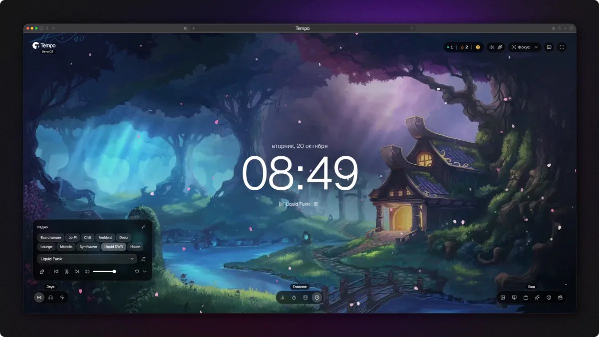
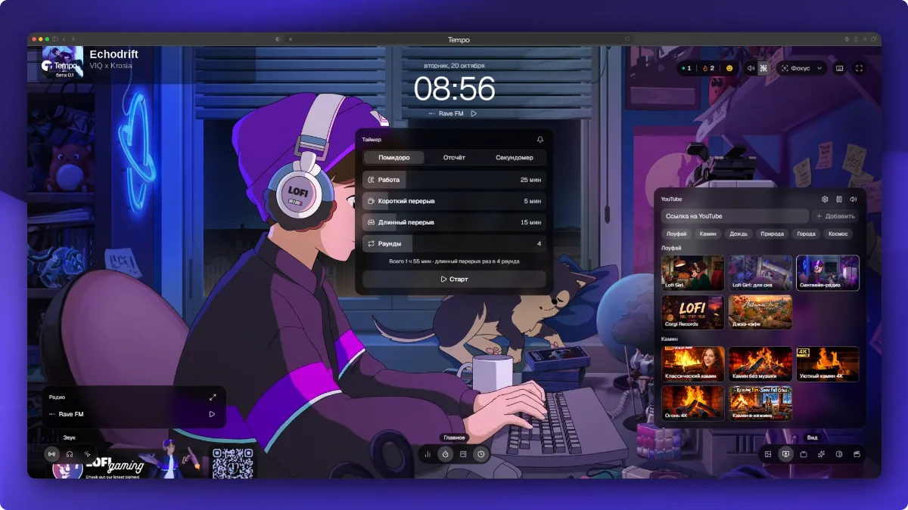

# Tempo

Атмосферная страница для отдыха и концентрации. Видео-фоны с виджетами поверх: интернет-радио, фоновые звуки, помидоро-таймер, статистика и летающие эффекты. Все окна открываются кнопками внизу экрана и могут работать одновременно.

🌐 **[Веб-сайт](https://tempo-1qlr.onrender.com/)**




## Что внутри

Страница — это фон, поверх которого открываются функциональные виджеты. Кнопки окон собраны в панель внизу экрана, у каждого окна есть **горячая клавиша**.

## Стек

- [React 19](https://react.dev) + [TypeScript 7](https://www.typescriptlang.org)
- [Astro 7](https://astro.build) (статика, React-остров), [Vite 8](https://vite.dev), [Tailwind CSS 4](https://tailwindcss.com)
- [shadcn/ui](https://ui.shadcn.com) на [Base UI](https://base-ui.com), иконки [Lucide](https://lucide.dev)
- [dnd-kit](https://dndkit.com) — перетаскивание на доске задач
- [Supabase](https://supabase.com) — счётчик «Сейчас на сайте» (Realtime Presence) и прокси к API радио (Edge Function)
- [Vitest](https://vitest.dev) — тесты, [oxlint](https://oxc.rs/docs/guide/usage/linter) и [Prettier](https://prettier.io) — линтер и форматирование

## Запуск

Нужны Node.js 24 и pnpm.

```sh
pnpm install
pnpm dev
```

### Переменные окружения

Без них всё работает, кроме живого онлайна: счётчик «Сейчас на сайте» покажет 1, а радио возьмёт станции из снимка в репозитории. Чтобы подключить Supabase, скопируйте [`.env.example`](.env.example) в `.env` и заполните:

| Переменная          | Что это                                                        |
| ------------------- | -------------------------------------------------------------- |
| `VITE_SUPABASE_URL` | Project URL из Project Settings → API (или просто ref проекта) |
| `VITE_SUPABASE_KEY` | Publishable (anon) key оттуда же                               |

Прокси для радио — Edge Function [`supabase/functions/record`](supabase/functions/record/README.md). API «Радио Рекорд» не отдаёт CORS-заголовки, поэтому браузер ходит к нему через неё:

```sh
supabase functions deploy record --no-verify-jwt
```

## Скрипты

| Команда                   | Что делает                                                      |
| ------------------------- | --------------------------------------------------------------- |
| `pnpm dev`                | dev-сервер с HMR                                                |
| `pnpm build`              | проверка типов и сборка в `dist/`                               |
| `pnpm preview`            | локальный просмотр собранной версии                             |
| `pnpm check`              | только проверка типов (`astro sync` и `tsc -b`)                 |
| `pnpm lint`               | oxlint и проверка форматирования Prettier                       |
| `pnpm format`             | форматирование Prettier                                         |
| `pnpm test`               | тесты Vitest один раз                                           |
| `pnpm test:watch`         | тесты в режиме наблюдения                                       |
| `pnpm record:snapshot`    | обновить снимок станций «Радио Рекорд» (`record-stations.json`) |
| `pnpm wallpaper:variants` | нарезать обои на размеры и форматы (AVIF/WebP, AV1/H.264)       |

На каждый push в `main` и на каждый pull request GitHub Actions запускает `check`, `lint`, `test` и `build` ([`.github/workflows/ci.yml`](.github/workflows/ci.yml)).

**Почему oxlint, а не ESLint:** `typescript-eslint` пока не поддерживает TypeScript 7. Oxlint не зависит от API TypeScript и проверяет те же правила хуков React (`rules-of-hooks`, `exhaustive-deps`). Настройки — в [`.oxlintrc.json`](.oxlintrc.json).

## Как устроен проект

```
src/
  pages/             страницы Astro: index.astro выводит приложение островом client:only
  layouts/           BaseLayout.astro: общий head (SEO, Open Graph, canonical)
  Root.tsx           корень острова: StrictMode и App
  App.tsx            раскладка: фон, окна, панель, слои эффектов
  widgets/
    registry.ts      реестр окон: кнопка, клавиша, место на экране
    dock/            панель внизу экрана
    <id>/            по папке на каждое окно: <Name>Widget.tsx, use<Name>.ts, логика с тестами
  components/ui/     компоненты shadcn/ui на Base UI
  lib/               общее: хранение, звук, приглушение, горячие клавиши
  hooks/             общие хуки
supabase/functions/  Edge Function — прокси к API радио
scripts/             снимки станций и нарезка обоев
docs/                подробные описания виджетов
```

Каждое окно описано в реестре [`src/widgets/registry.ts`](src/widgets/registry.ts): там его кнопка, горячая клавиша и место на экране. С `xl` (1280px) окна стоят в трёх колонках CSS-сетки, ниже на экране одно окно за раз. Логика, которую стоит тестировать, живёт в обычных модулях без React, тесты лежат рядом с кодом (`phases.ts` → `phases.test.ts`).

Правила для добавления виджетов — в [`AGENTS.md`](AGENTS.md). Компоненты shadcn/ui добавляются командой `pnpm dlx shadcn@latest add <component>` и попадают в `src/components/ui/`.

## Документация

- [Виджеты и панель](docs/widgets.md)
- [Страницы](docs/pages.md)
- [Радио](docs/radio.md)
- [Звуки](docs/ambience.md)
- [Таймер](docs/timer.md)
- [Задачи](docs/tasks.md)
- [Статистика](docs/stats.md)
- [Обои](docs/wallpaper.md)
- [YouTube-фон](docs/youtube.md)
- [Проигрыватель](docs/player.md)
- [Окно Twitch](docs/twitch.md)
- [Эффекты](docs/effects.md)
- [Затемнение](docs/dimmer.md)
- [Сцены и первый экран](docs/scenes.md)
- [Режим фокуса и крупные часы](docs/focus.md)
- [Горячие клавиши](docs/hotkeys.md)

## Лицензия и источники

Код распространяется по лицензии [MIT](LICENSE).

Медиафайлы в `src/assets/` под лицензию MIT не попадают:

- **Фоны в стиле Warcraft** (Альянс, Орда) сгенерированы нейросетью. Warcraft и связанные с ним образы — товарные знаки Blizzard Entertainment. Проект фанатский и не связан с Blizzard.
- **Видеофоны** взяты с [MotionBGs](https://motionbgs.com/) и принадлежат их авторам.
- **Фоновые звуки** взяты с [Pixabay](https://pixabay.com/sound-effects/) и используются по [лицензии Pixabay](https://pixabay.com/service/license-summary/).
- **Радио:** звук идёт напрямую с серверов «Радио Рекорд», список станций берётся через их неофициальный API.
