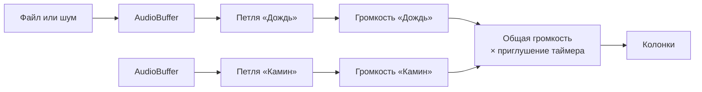

# Звуки

Микшер фоновых звуков: камин, дождь, ветер, шумы и т. д. Можно включить несколько звуков сразу, у каждого своя громкость, сверху общая громкость и пауза. Звуки играют **поверх радио**, а не вместо него.

Окно открывается кнопкой «Звуки» (наушники) на [панели](widgets.md#панель) внизу. Положение задаёт [`src/App.tsx`](../src/App.tsx): левый верхний угол, на телефоне — над панелью во всю ширину.

## Где код

| Файл                                                                                    | Что внутри                                                                                                    |
| --------------------------------------------------------------------------------------- | ------------------------------------------------------------------------------------------------------------- |
| [`src/widgets/ambience/sounds.ts`](../src/widgets/ambience/sounds.ts)                   | Список звуков по группам: id, название, иконка, источник. Сюда добавлять новые звуки                          |
| [`src/widgets/ambience/useAmbience.ts`](../src/widgets/ambience/useAmbience.ts)         | Состояние: какие звуки включены, громкости, пауза, `localStorage`. Передаёт уровни в движок                   |
| [`src/widgets/ambience/AmbienceWidget.tsx`](../src/widgets/ambience/AmbienceWidget.tsx) | Разметка: общая громкость, группы, строки звуков. Логики нет, только вызов `useAmbience`                      |
| [`src/lib/ambience.ts`](../src/lib/ambience.ts)                                         | Движок на Web Audio: `AudioContext`, загрузка и кэш файлов, генерация шумов, петли, плавные включения         |
| [`src/assets/ambience/`](../src/assets/ambience/)                                       | Файлы звуков. Имя файла без расширения — id звука                                                             |
| [`src/hooks/useDuckLevel.ts`](../src/hooks/useDuckLevel.ts)                             | Множитель громкости вокруг сигнала таймера. Общий с радио, подробно в [timer.md](timer.md#приглушение-музыки) |

## Список звуков

| Группа  | id             | Название       | Источник            |
| ------- | -------------- | -------------- | ------------------- |
| Таверна | `fireplace`    | Камин          | `fireplace.mp3`     |
| Таверна | `tavern`       | Гул таверны    | `tavern.mp3`        |
| Природа | `rain`         | Дождь          | `rain.mp3`          |
| Природа | `thunderstorm` | Гроза          | `thunderstorm.mp3`  |
| Природа | `wind`         | Ветер          | `wind.mp3`          |
| Природа | `blizzard`     | Метель         | `blizzard.mp3`      |
| Природа | `forest`       | Лес            | `forest.mp3`        |
| Природа | `birds`        | Птицы          | `birds.mp3`         |
| Природа | `crickets`     | Сверчки        | `crickets.mp3`      |
| Природа | `stream`       | Ручей          | `stream.mp3`        |
| Природа | `ocean`        | Океан          | `ocean.mp3`         |
| Природа | `underwater`   | Под водой      | `underwater.mp3`    |
| Шумы    | `white-noise`  | Белый шум      | Генерируется в коде |
| Шумы    | `pink-noise`   | Розовый шум    | Генерируется в коде |
| Шумы    | `brown-noise`  | Коричневый шум | Генерируется в коде |

Сейчас файлы есть у всех звуков. Если файла нет, звук виден в списке, но неактивен. При наведении подсказка называет файл, который нужно положить.

## Как добавить файл звука

1. Положи файл в `src/assets/ambience/`. **Имя без расширения должно совпадать с id** из `sounds.ts`: `forest.mp3` → звук «Лес».
2. Всё. `sounds.ts` находит файлы через `import.meta.glob` при сборке, правка кода не нужна. В dev-режиме Vite подхватит новый файл сам, иногда нужно обновить страницу.

Чтобы добавить **новый** звук, которого нет в таблице:

1. Положи файл, например `cat.mp3`.
2. Добавь строку в нужную группу в `ambientGroups` в [`sounds.ts`](../src/widgets/ambience/sounds.ts): `file('cat', 'Кот у камина', Cat)`. Иконку бери из [lucide](https://lucide.dev/icons).
3. Добавь строку в [список звуков](#список-звуков) выше.

Новая группа — новый объект `{ label, sounds }` в `ambientGroups`. Порядок в массиве — порядок на экране.

### Требования к файлу

| Что        | Как                                                                                                                                 |
| ---------- | ----------------------------------------------------------------------------------------------------------------------------------- |
| Формат     | `.mp3` или `.m4a` — работают во всех браузерах. Ещё принимаются `.ogg`, `.opus`, `.wav`, `.webm`, но `.ogg` плохо работает в Safari |
| Длина      | 30 секунд — 2 минуты. Короче — повтор слышен на слух, длиннее — лишний вес                                                          |
| Вес        | До 1–2 МБ. Это сжатый mp3 на 96–128 kbps. `.wav` не клади: он в 10 раз тяжелее                                                      |
| Петля      | Конец должен плавно переходить в начало, без затухания и щелчка. Ищи записи со словом **loop** или обрежь в Audacity                |
| Содержимое | Без музыки и голосов, ровный фон без резких событий: одинокий раскат грома каждые 40 секунд быстро начинает раздражать              |
| Громкость  | Примерно одинаковая у всех файлов. Если звук выбивается, нормализуй его, а не меняй уровень в коде                                  |
| Лицензия   | CC0 или аналогичная, без обязательного указания автора                                                                              |

Один id — один файл. Если в папке лежат и `rain.mp3`, и `rain.wav`, сработает только один из них, какой — не гарантируется.

### Где искать

Бесплатные записи: [freesound.org](https://freesound.org) (фильтр License → Creative Commons 0) и [pixabay.com/sound-effects](https://pixabay.com/sound-effects/).

| Звук           | Что вбить в поиск                       |
| -------------- | --------------------------------------- |
| Камин          | `fireplace crackling loop`, `campfire`  |
| Гул таверны    | `tavern ambience`, `medieval inn crowd` |
| Дождь          | `rain loop`, `light rain on window`     |
| Гроза          | `thunderstorm rain loop`                |
| Ветер / метель | `wind howling loop`, `blizzard`         |
| Лес            | `forest ambience`                       |
| Птицы          | `forest birds ambience`                 |
| Сверчки        | `crickets night ambience`               |
| Ручей          | `stream creek loop`                     |
| Океан          | `ocean waves loop`                      |
| Под водой      | `underwater ambience`                   |

## Как устроен звук

Звуки играют не через `<audio>`, а через Web Audio. У `<audio loop>` на стыке петли бывает слышная пауза, особенно у mp3, а на дожде или ветре она сразу режет слух. `AudioBufferSourceNode` с `loop = true` склеивает петлю без паузы.



- **Один `AudioContext`** на все звуки, модульная переменная в `ambience.ts`. Создаётся при первом включении звука, а не при загрузке страницы.
- **Загрузка по требованию.** Файл скачивается и раскодируется только при первом включении его звука, а не при открытии страницы. Раскодированный `AudioBuffer` хранится в памяти до перезагрузки, повторное включение ничего не качает. Пока файл грузится, вместо иконки крутится спиннер, при ошибке — красная иконка.
- **Плавность.** Громкость меняется через `setTargetAtTime`: звук нарастает и затихает примерно за секунду. Выключенная петля через 2 секунды после затухания останавливается, чтобы не крутиться впустую.
- **Случайный старт.** Петля начинается со случайного места файла, чтобы после каждого включения звучала по-разному.
- **Шумы** генерируются в `createNoise`: 8 секунд стерео. Белый — равномерный случайный сигнал, розовый — фильтр Пола Келлета, коричневый — накопленный (интегрированный) белый шум. На стыке петли у шума шва не слышно.

### Связь виджета и движка

`useAmbience` хранит состояние в React и при каждом изменении отдаёт движку итоговые уровни. Движок про React не знает.

| Функция движка                      | Кто вызывает                            | Что делает                                                                              |
| ----------------------------------- | --------------------------------------- | --------------------------------------------------------------------------------------- |
| `setSoundLevel(id, source, l)`      | Эффект в `useAmbience`                  | Громкость звука 0–1. Больше нуля — загрузить и запустить, ноль — затухнуть и остановить |
| `setAmbienceLevel(l)`               | Эффект в `useAmbience`                  | Общая громкость × множитель приглушения                                                 |
| `unlockAmbience()`                  | `useAmbience` прямо в обработчике клика | Создаёт и «будит» `AudioContext`. Safari пускает звук только внутри обработчика клика   |
| `subscribeStatuses` / `getStatuses` | `useSyncExternalStore` в `useAmbience`  | Какие звуки сейчас грузятся (`loading`) и какие не загрузились (`error`)                |
| `pruneSoundCache(urls)`             | `useAmbience` один раз при загрузке     | Удаляет из кэша файлы, которых больше нет в сборке                                      |

Уровень звука = `playing && on ? громкость звука : 0`. Общий уровень = `общая громкость × useDuckLevel()`.

## Поведение

| Действие                             | Что происходит                                                                                      |
| ------------------------------------ | --------------------------------------------------------------------------------------------------- |
| Нажать на название звука             | Включает или выключает его. Если звуки на паузе, запускает воспроизведение                          |
| Включить звук с ползунком на 0%      | Ползунок встаёт на 50%, иначе включилась бы тишина                                                  |
| Сдвинуть ползунок выключенного звука | Звук включается — быстрее, чем нажать и потом настроить                                             |
| Опустить ползунок до 0%              | Звук выключается                                                                                    |
| Выключить звук                       | Громкость запоминается, при следующем включении он заиграет с ней                                   |
| Кнопка ▶ / ⏸ в заголовке             | Пауза и продолжение всех включённых звуков. Неактивна, если ни один звук не включён                 |
| Сигнал таймера                       | Звуки затихают вместе с радио и возвращаются после колокольчика                                     |
| Закрыть окно на панели               | Звуки продолжают играть: окно скрывается, а не удаляется со страницы                                |
| Перезагрузить страницу               | Набор звуков и громкости восстанавливаются, но **на паузе** — как у радио. Играть начнут по нажатию |

Нетронутые звуки стоят на 0%. Общая громкость по умолчанию 80%.

## Что сохраняется

| Что                                              | Где                                    | Переживает перезагрузку              |
| ------------------------------------------------ | -------------------------------------- | ------------------------------------ |
| Общая громкость, включённые звуки и их громкость | `localStorage`, ключ `tempo:ambience`  | Да                                   |
| Играет или на паузе                              | `useState` в `useAmbience`             | Нет, после перезагрузки всегда пауза |
| Раскодированные звуки                            | `Map` в памяти `ambience.ts`           | Нет                                  |
| Скачанные файлы                                  | Cache Storage, кэш `tempo-ambience-v1` | Да, только в собранной версии        |

Формат `tempo:ambience`:

```json
{ "volume": 0.8, "sounds": { "rain": { "on": true, "volume": 0.5 } } }
```

Звука, который ни разу не трогали, в `sounds` нет.

## Кэш файлов

Скачанный файл кладётся в Cache Storage (`fetchSound` в `ambience.ts`). При следующих визитах звук берётся оттуда без сети.

- **Только в собранной версии.** В `pnpm dev` у файлов нет хэша в имени (`/src/assets/ambience/rain.mp3`), и после замены файла играл бы старый звук из кэша. Поэтому в dev кэш выключен (`import.meta.env.DEV`). Проверять кэш — через `pnpm build` и `pnpm preview`.
- **Устаревшие файлы удаляются сами.** После сборки имя файла содержит хэш содержимого (`rain-UZVu6f8M.mp3`). Заменил файл — поменялся хэш. При загрузке страницы `pruneSoundCache` удаляет из кэша всё, чего нет в текущей сборке.
- **Сбросить кэш целиком** — поменять `cacheName` (`tempo-ambience-v1` → `v2`). Старый кэш при этом останется в браузере, пока его не удалит пользователь или браузер, поэтому без нужды не меняй.
- **Ошибки кэша не мешают звуку.** Нет Cache Storage (http-сайт, некоторые приватные режимы) или кончилось место — файл просто скачивается каждый раз.
- **Генерируемые шумы не кэшируются**: их нечего скачивать, они создаются за доли секунды.

Посмотреть кэш: DevTools → Application → Cache storage → `tempo-ambience-v1`.

## Подводные камни

- **`vite preview` запоминает файлы при старте.** Если пересобрать проект, уже запущенный `pnpm preview` продолжит отдавать старую сборку. Перезапусти его.
- **Автозапуск.** `AudioContext` нельзя запустить без клика пользователя. Поэтому после перезагрузки звуки ждут нажатия, а `unlockAmbience` вызывается синхронно в обработчиках `toggleSound`, `changeSoundVolume` и `togglePlaying`, а не в эффекте.
- **Фоновая вкладка.** Пока играют звуки, Chrome не замедляет таймеры вкладки — как и с радио.
- **Подсказка про файл всегда говорит `.mp3`**, хотя подойдёт и `.m4a`.
