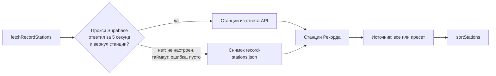
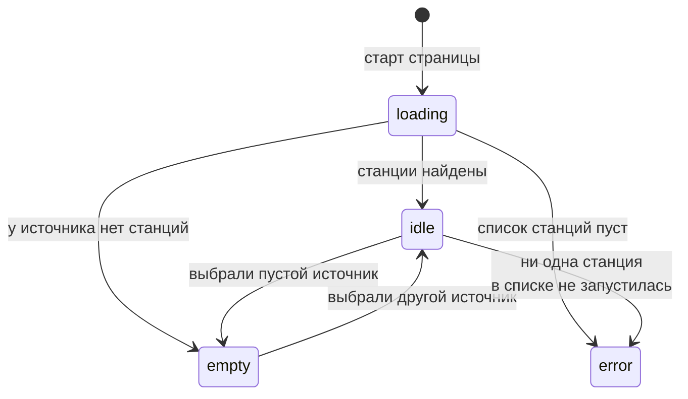
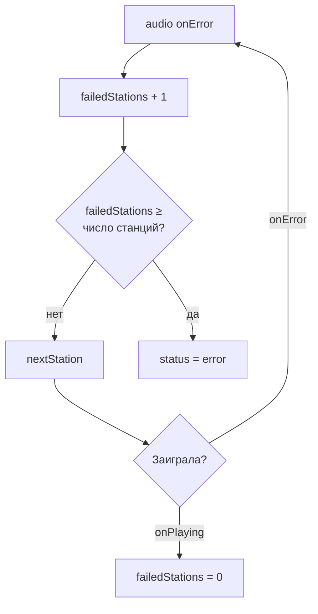

# Радио

Виджет, в котором играют станции «Радио Рекорд» (117 станций). Данные берутся из внутреннего неофициального API Рекорда: он закрыт для браузера по CORS, поэтому запросы идут через Edge Function на Supabase, а при её недоступности виджет работает на снимке станций из репозитория.

Загруженная музыка (`src/assets/music/`) временно скрыта флагом `musicEnabled` в [`src/widgets/registry.ts`](../src/widgets/registry.ts). Её плеер лежит в [`src/widgets/music/BackgroundMusic.tsx`](../src/widgets/music/BackgroundMusic.tsx).

Положение виджета задаёт реестр [`src/widgets/registry.ts`](../src/widgets/registry.ts): он отвечает только за место на экране (левый нижний угол, над [панелью](widgets.md#панель)), всё остальное внутри `src/widgets/radio/`. Если закрыть окно радио на панели, радио продолжит играть. Поверх радио можно включить [фоновые звуки](ambience.md).

## Где код

| Файл                                                                                      | Что внутри                                                                                                      |
| ----------------------------------------------------------------------------------------- | --------------------------------------------------------------------------------------------------------------- |
| [`src/widgets/radio/RadioWidget.tsx`](../src/widgets/radio/RadioWidget.tsx)               | Разметка виджета и элемент `<audio>`. Логики нет, только вызовы хуков                                           |
| [`src/widgets/radio/useRadio.ts`](../src/widgets/radio/useRadio.ts)                       | Вся логика: загрузка станций, источник, очередь, воспроизведение, громкость, перебор неработающих станций       |
| [`src/widgets/radio/useFavoriteStations.ts`](../src/widgets/radio/useFavoriteStations.ts) | Избранное: хранение в `localStorage`, добавление и удаление                                                     |
| [`src/widgets/radio/record.ts`](../src/widgets/radio/record.ts)                           | Тип `RecordStation` и приведение ответа API к нему                                                              |
| [`src/widgets/radio/recordApi.ts`](../src/widgets/radio/recordApi.ts)                     | Клиент: `fetchRecordStations` (прокси, затем снимок) и `fetchRecordNow` (что играет сейчас)                     |
| [`src/widgets/radio/record-stations.json`](../src/widgets/radio/record-stations.json)     | Снимок станций (`pnpm record:snapshot`)                                                                         |
| [`src/widgets/radio/genres.ts`](../src/widgets/radio/genres.ts)                           | Пресеты для фокуса: списки `prefix` станций Рекорда                                                             |
| [`src/widgets/radio/stations.ts`](../src/widgets/radio/stations.ts)                       | Источники (`stationsForSource`), сортировка, место станции в очереди, локальный поиск                           |
| [`src/widgets/radio/saved.ts`](../src/widgets/radio/saved.ts)                             | Разбор и миграция сохранённого в `localStorage`                                                                 |
| [`src/widgets/radio/useRecordTrack.ts`](../src/widgets/radio/useRecordTrack.ts)           | Хук: опрашивает `fetchRecordNow` и отдаёт трек текущей станции                                                  |
| [`src/widgets/radio/trackPolling.ts`](../src/widgets/radio/trackPolling.ts)               | Расписание опроса трека и пауза после неудач (чистая логика)                                                    |
| [`src/widgets/radio/audioAnalyser.ts`](../src/widgets/radio/audioAnalyser.ts)             | Анализатор звука для эквалайзера: один на `<audio>`, общий цикл кадров                                          |
| [`src/widgets/radio/soundLevels.ts`](../src/widgets/radio/soundLevels.ts)                 | Уровни полосок по спектру и определение «анализатор молчит» (чистая логика)                                     |
| [`src/widgets/radio/SoundBars.tsx`](../src/widgets/radio/SoundBars.tsx)                   | Полоски эквалайзера: живые уровни или запасная CSS-анимация                                                     |
| [`src/widgets/radio/mediaSession.ts`](../src/widgets/radio/mediaSession.ts)               | Данные для системного плеера (Media Session API)                                                                |
| [`src/widgets/radio/nowPlaying.ts`](../src/widgets/radio/nowPlaying.ts)                   | Текущая станция для строки под крупными часами и переключатель радио                                            |
| [`src/hooks/useAutoplay.ts`](../src/hooks/useAutoplay.ts)                                 | Запуск звука, в том числе после первого клика, если браузер заблокировал автозапуск. Общий с музыкой            |
| [`src/widgets/Widget.tsx`](../src/widgets/Widget.tsx)                                     | Общая «стеклянная» оболочка виджетов                                                                            |
| [`src/components/ui/combobox.tsx`](../src/components/ui/combobox.tsx)                     | `Combobox` (поле с локальным поиском, выбор станции) и `ComboboxButton` (список за кнопкой-шевроном, избранное) |
| [`src/components/ui/slider.tsx`](../src/components/ui/slider.tsx)                         | Слайдер громкости на Base UI                                                                                    |

## Откуда берутся станции

- **Прокси.** Edge Function `supabase/functions/record` ходит в API Рекорда за списком станций и возвращает его браузеру. Адрес и ключ задают `VITE_SUPABASE_URL` и `VITE_SUPABASE_KEY`.
- **Снимок.** `record-stations.json` хранит уже нормализованные станции (`RecordStation[]`), а не сырой ответ API. Обновляется командой `pnpm record:snapshot`. Если прокси не настроен или не отвечает, виджет полностью работает на снимке. Читается разбором из `saved.ts` (`snapshotStations`).
- **Станция** (`RecordStation`): `id`, `prefix`, `title`, `genres`, `stream`, а также необязательные `hls`, `color`, `icon` и `sort`. Играет `stream`: https, aac, 128 кбит/с, при его отсутствии 320, затем 64. HLS виджет пока не использует. Станции без https-потока при нормализации отбрасываются.

### Источники и сортировка

- **Источник** (`StationSource`): `{ kind: 'all' }`, все станции Рекорда в их порядке, или `{ kind: 'genre', genre }`, один из пресетов для фокуса.
- **Пресеты** (`genres.ts`): Lo-Fi, Chill, Ambient, Deep, Lounge, Melodic, Synthwave, Liquid D'n'B, House. Чипы источников (первым «Все станции») переносятся по строкам. Каждый задан списком `prefix`; станции, которых нет в ответе, пропускаются. Порядок `prefix` в пресете и есть порядок «По порядку».
- **Кнопка порядка** стоит в одном ряду с выпадающим списком станций, справа от него (иконка `Shuffle` или `ListOrdered`).
- **Сортировка** (`RadioSort`): `shuffle` (по умолчанию) перемешивает очередь, `default` оставляет порядок Рекорда (у пресета — порядок в пресете).
- **Поиск по названию** локальный: он есть у комбобокса станций (встроенная фильтрация по тексту) и у списка избранного, сеть не нужна.

## Что играет сейчас

`fetchRecordNow()` возвращает треки всех станций сразу (`RecordTrack`: `stationId`, `artist`, `song`, `cover?`). `useRecordTrack` берёт из них трек станции с `stationId === station.id`. Без ответа прокси трека нет, и всё выглядит как раньше.

- **Когда опрашиваем.** Только пока радио включено (`playing`) и вкладка видна (`document.visibilityState`): раз в 20 секунд, плюс сразу при смене станции, включении радио и возврате на вкладку.
- **Бэкофф.** Если запрос не удался или вернул пустой список (прокси не задеплоен или недоступен), следующая попытка не раньше чем через 2 минуты, даже при смене станции. Так консоль не засыпается ошибками CORS. Расписание — в `trackPolling.ts` (`trackPollDelay`), тесты в `trackPolling.test.ts`.
- **Где виден.** В окне радио строка «Исполнитель — Песня» с маленькой обложкой (между выбором станции и кнопками; в свёрнутом виде вторая строка под названием станции, без обложки). Под датой на крупных часах (`StationRow` в `BigClock.tsx`): трек, а без него название станции. Трек лежит в `NowPlaying.track` ([`nowPlaying.ts`](../src/widgets/radio/nowPlaying.ts)), `setNowPlaying` сравнивает и его.
- **Системный плеер.** Пока радио включено, `navigator.mediaSession.metadata` получает: `title` — песня или станция, `artist` — исполнитель или «Радио Рекорд», `artwork` — обложка трека или иконка станции. Без поддержки API ничего не происходит.

## Эквалайзер

Полоски (`SoundBars`) показывают настоящий спектр. Потоки Рекорда отдают CORS, поэтому у `<audio>` стоит `crossOrigin="anonymous"` (до `src`), а звук идёт через граф Web Audio: `<audio>` → `AnalyserNode` → выход общего `AudioContext` ([`getAudioContext`](../src/lib/audio.ts)). Громкость, mute и приглушение (`duckLevel`) задают свойства самого `<audio>`, поэтому работают как раньше (полоски при этом тоже тише: анализатор слышит уже приглушённый звук).

- **Один анализатор и один цикл.** `audioAnalyser.ts` создаёт `MediaElementSource` один раз на элемент (повторно нельзя). Окно радио и крупные часы подписываются на один цикл `requestAnimationFrame`; цикл идёт, только пока есть подписчики. Подписан тот, у кого звук идёт и полоски видны: на паузе, при скрытом окне (`IntersectionObserver`) и при `prefers-reduced-motion` подписки нет, полоски стоят.
- **Звук не пропадает.** После `createMediaElementSource` звук слышен только при `running`-контексте, поэтому узел создаётся, лишь когда контекст уже разблокирован: `unlockAudio()` вызывается в `togglePlaying` (клик включения) и в запасном пути `useAutoplay`. До этого радио играет напрямую, а полоски — на CSS. Если браузер потом приостановит контекст, `statechange` его резюмирует.
- **Запасной вариант.** Анализатора нет (контекст не разблокирован, Web Audio недоступен, ошибка создания) или ~3 секунды одни нули при слышимом звуке (не пауза, не mute, громкость выше 0.05) — полоски тихо переходят на прежнюю CSS-анимацию. Сломанный элемент помечается и больше не пробуется.
- **Полоски.** 4 полосы спектра (бас → верха), уровень от 0.2 до 1 (`bandLevels` в `soundLevels.ts`) пишется прямо в `transform` без перерисовок React.

## Состояния загрузки

`status` из `useRadio` показывает, что сейчас в верхнем ряду виджета: комбобокс станций или текст.

Загрузка не падает: `fetchRecordStations` при сбое прокси отдаёт снимок, поэтому `error` бывает только если не заиграла ни одна станция.

| Статус    | Что видно вместо комбобокса станций  |
| --------- | ------------------------------------ |
| `idle`    | Комбобокс станций                    |
| `loading` | «Ищем станции…»                      |
| `empty`   | «В этом жанре нет доступных станций» |
| `error`   | «Не удалось подключиться к радио»    |

## Основные сценарии

### Смена источника

Кнопки «Все станции» и пресеты вызывают `loadStations(source)`: из каталога собирается очередь источника, сортируется и играет с первой станции. Источник запоминается.

### Избранное и выбор станции

`playStation` включает станцию сразу, если она есть в текущей очереди. Иначе (избранное из другого пресета) очередью становятся все станции Рекорда, а выбранная встаёт на своё место или в начало.

### Станция не запускается

Когда станция закончила вещание (`onEnded`), тоже включается следующая.

## Кнопки виджета

Верхний ряд: порядок станций и источники (в одном потоке с переносом строк). Ниже: комбобокс станции. Нижний ряд слева направо:

| Кнопка             | Иконка                             | Функция                          | Что делает                                                         | Неактивна                        |
| ------------------ | ---------------------------------- | -------------------------------- | ------------------------------------------------------------------ | -------------------------------- |
| Порядок            | `Shuffle` / `ListOrdered`          | `changeSort`                     | Переключает «Перемешать» и «По порядку», играющая станция остаётся | Никогда                          |
| Случайная станция  | `Dices`                            | `randomStation`                  | Случайная станция текущей очереди, кроме играющей                  | Меньше двух станций              |
| Вкл/выкл           | `Pause` / `Play`                   | `togglePlaying`                  | Пауза или запуск. При включении поток перезагружается              | Никогда                          |
| Без звука          | `VolumeX` / `Volume1` / `Volume2`  | `toggleMuted`                    | Глушит звук, громкость при этом запоминается                       | Никогда                          |
| Громкость          | слайдер                            | `changeVolume`                   | 0–1, шаг 0.01. Сдвиг слайдера выше нуля снимает режим без звука    | Никогда                          |
| Предыдущая станция | `SkipBack`                         | `prevStation`                    | Назад по очереди, по кругу                                         | Загрузка или нет станций         |
| Следующая станция  | `SkipForward`                      | `nextStation`                    | Вперёд по очереди, по кругу                                        | Загрузка или нет станций         |
| В избранное        | `Heart` (залито, если в избранном) | `toggleFavorite`                 | Добавляет или убирает текущую станцию                              | Нет станции или статус не `idle` |
| Список избранного  | `ChevronDown`                      | `ComboboxButton` → `playStation` | Список избранного с поиском                                        | Никогда                          |

## Состояние и хранение

Всё, кроме избранного, живёт в `useRadio`.

### При загрузке страницы

Радио всегда выключено: звук включает только пользователь кнопкой «Вкл/выкл». Станции загружаются (прокси или снимок), очередь собирается из сохранённого источника, а последняя заигравшая станция встаёт на своё место в очереди (или в начало, если в источнике её нет), но не играет. Пока радио выключено, у `<audio>` стоит `preload="none"`, поэтому поток не качается в фоне.

| Что                                   | Где                                                 | Переживает перезагрузку?                                |
| ------------------------------------- | --------------------------------------------------- | ------------------------------------------------------- |
| `playing`: играет или на паузе        | `useState`                                          | Нет, радио всегда стартует выключенным                  |
| `volume`, `muted`                     | `useState`                                          | Нет, громкость сбрасывается на 0.8                      |
| Приглушение вокруг сигнала таймера    | `useDuckLevel` (множитель к `volume`)               | Нет. Подробно в [timer.md](timer.md#приглушение-музыки) |
| `source`, `sort`                      | `usePersistentState`                                | **Да**                                                  |
| `catalog`: все станции Рекорда        | `useState`                                          | Нет, при загрузке берётся заново                        |
| `stations`: очередь                   | `useState`                                          | Нет                                                     |
| `currentStation`: индекс в `stations` | `useState`                                          | Нет, но последняя станция восстанавливается             |
| Последняя заигравшая станция          | `localStorage`                                      | **Да**                                                  |
| `favorites`                           | `useState` + `localStorage` в `useFavoriteStations` | **Да**                                                  |
| `failedStations`                      | `useRef`                                            | Нет. Сколько станций подряд не запустилось              |

### Что лежит в localStorage

| Ключ                      | Что                                                                    | Когда пишется                                                     |
| ------------------------- | ---------------------------------------------------------------------- | ----------------------------------------------------------------- |
| `tempo:last-station`      | Последняя станция целиком (`RecordStation`)                            | Когда станция реально заиграла (`onPlaying`), а не просто выбрана |
| `tempo:favorite-stations` | Избранное: объект «id Рекорда → `RecordStation`»                       | При нажатии на сердечко                                           |
| `tempo:radio-source`      | `{ "kind": "all" }` или `{ "kind": "genre", "genre": "<id пресета>" }` | При смене источника                                               |
| `tempo:radio-sort`        | `"shuffle"` или `"default"`                                            | При смене порядка                                                 |
| `tempo:radio-compact`     | Свёрнуто ли окно                                                       | При сворачивании                                                  |

Станции хранятся целиком, чтобы показать и включить их без запроса к API. Бесконечный `sort` при записи в JSON превращается в `null`; `saved.ts` возвращает его обратно в `Infinity`. Если `localStorage` недоступен (приватный режим), настройки живут до перезагрузки страницы.

### Миграция старых настроек (Radio Browser)

Раньше радио работало на Radio Browser. Разбор в [`saved.ts`](../src/widgets/radio/saved.ts) принимает и старый формат (правило из [AGENTS.md](../AGENTS.md)), тесты лежат в `saved.test.ts` и `src/widgets/saved-formats.test.ts`.

| Что                                                       | Было                                   | Станет                                                                                                                                                                                                                                           |
| --------------------------------------------------------- | -------------------------------------- | ------------------------------------------------------------------------------------------------------------------------------------------------------------------------------------------------------------------------------------------------ |
| Избранное и последняя станция                             | Станция Radio Browser (`url_resolved`) | Если поток на `radiorecord.hostingradio.ru`, станция Рекорда с тем же именем файла потока (без учёта http/https и регистра; если битрейт в имени другой — по имени без цифр, когда подходит ровно одна станция). Остальные станции отбрасываются |
| `tempo:radio-source`: `country`, `search`                 | Страна или поиск                       | `{ kind: 'all' }`                                                                                                                                                                                                                                |
| `tempo:radio-source`: жанры `lofi`, `ambient`, `chillout` | Жанр Radio Browser                     | Пресеты с теми же id; остальные старые жанры (jazz, piano…) становятся `all`                                                                                                                                                                     |
| `tempo:radio-sort`: `popular`                             | Сортировка по голосам                  | `default`                                                                                                                                                                                                                                        |
| `tempo:liked-stations`                                    | Голоса за станции                      | Ключ больше не используется, данные в браузере остаются лежать нетронутыми                                                                                                                                                                       |

## Неочевидные решения

- **Очередь перемешана, но в комбобоксе список по порядку очереди.** Режим «Перемешать» нужен, чтобы «следующая» и «предыдущая» каждый раз давали разное. Переключение порядка не прерывает станцию: она остаётся играть и находит своё место в новой очереди.
- **После паузы поток перезагружается.** Прямой эфир после паузы продолжился бы с того места, где его остановили. Поэтому `togglePlaying` при включении вызывает `audio.load()`, и звук возвращается к живому эфиру.
- **Последняя станция сохраняется по `onPlaying`.** Если сохранять при выборе, после перезагрузки можно получить станцию, которая так и не запустилась.
- **Запуск после первого клика остался в `useAutoplay`.** Радио включается кнопкой, а это и есть клик, поэтому браузер звук не блокирует. Запасной путь нужен фоновой музыке, которая стартует сама.
- **Станция не из источника ставится в начало.** Так бывает с избранным и последней станцией: пресет не обязан её содержать, но выбранное пользователем не должно пропадать.
- **Свежая версия станции берётся из каталога.** Сохранённая последняя станция при загрузке заменяется станцией с тем же `id` из актуального списка.
