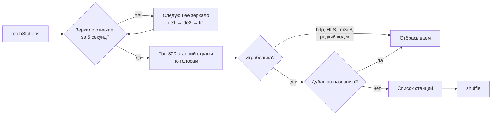
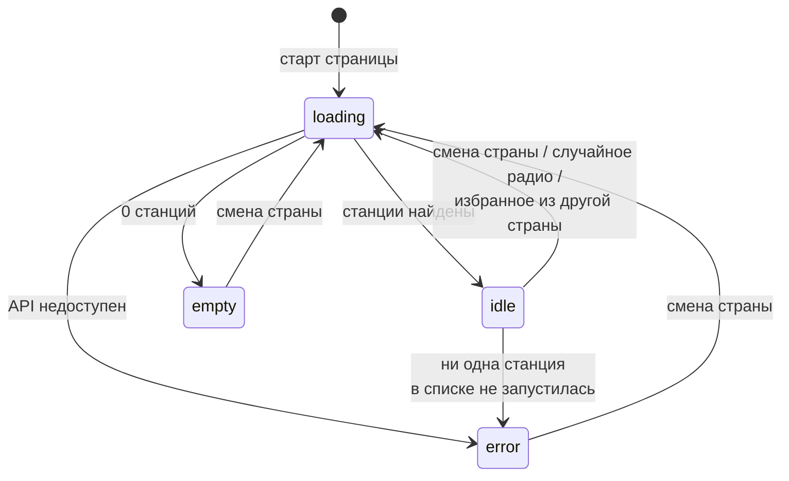
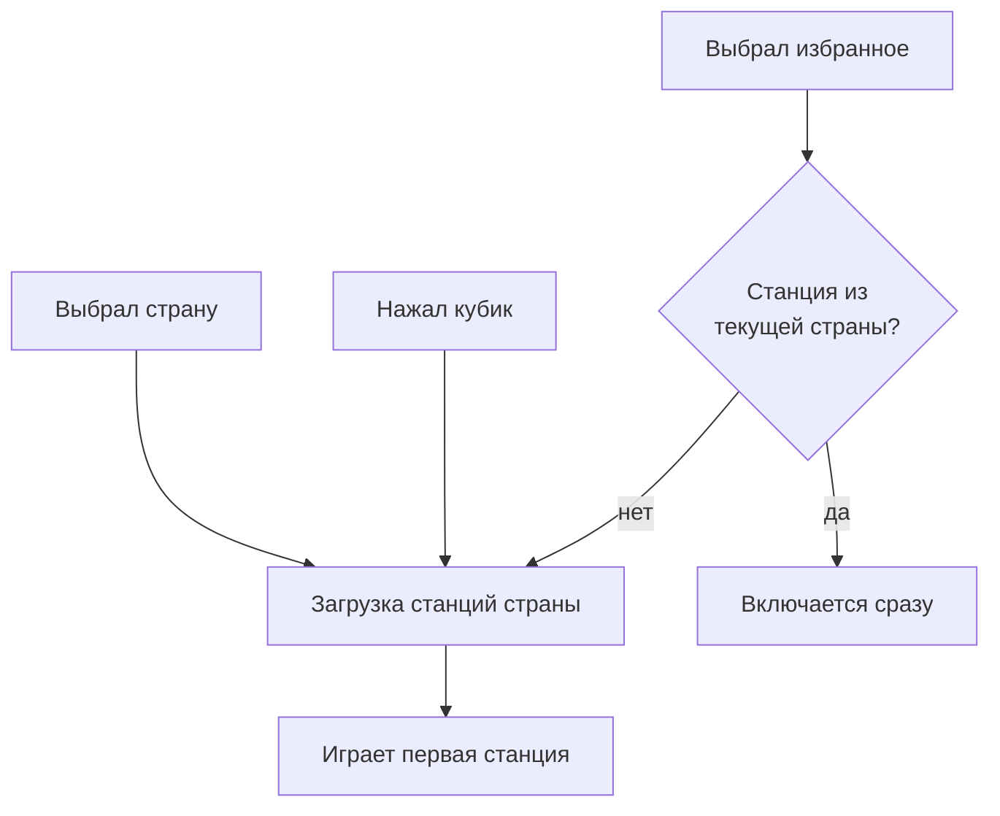
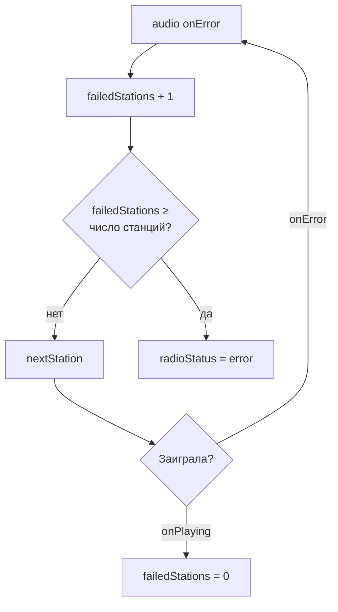

# Радио

Виджет, в котором играет интернет-радиостанции со всего мира. Станции и страны берутся из открытой базы [Radio Browser](https://www.radio-browser.info).

Загруженная музыка (`src/assets/music/`) временно скрыта флагом, подробнее в разделе [«Неочевидные решения»](#неочевидные-решения).

## Где код

| Файл                                                                  | Что внутри                                                                                                              |
| --------------------------------------------------------------------- | ----------------------------------------------------------------------------------------------------------------------- |
| [`src/App.tsx`](../src/App.tsx)                                       | Всё состояние радио, обработчики кнопок, элемент `<audio>`, разметка виджета                                            |
| [`src/lib/radio.ts`](../src/lib/radio.ts)                             | Клиент Radio Browser API: зеркала, загрузка стран и станций, фильтр «играбельных» станций, страна по умолчанию          |
| [`src/components/ui/combobox.tsx`](../src/components/ui/combobox.tsx) | `Combobox` (поле с поиском, выбор страны и станции) и `ComboboxButton` (список за кнопкой-шевроном, избранное). Base UI |
| [`src/components/ui/slider.tsx`](../src/components/ui/slider.tsx)     | Слайдер громкости на Base UI                                                                                            |

## Откуда берутся станции



- **Играбельна** означает, что поток идёт по `https` (на https-сайте браузер не даст играть http), это не HLS и кодек один из `MP3`, `AAC`, `AAC+`, `OGG`.
- **Страны** загружает `fetchCountries`. В список попадают только страны, где 10 и больше станций. Названия переводятся на русский через `Intl.DisplayNames`.
- **Страна по умолчанию** определяется по языку браузера (`ru-RU` → `RU`), запасной вариант `US`.

## Состояния загрузки

`radioStatus` показывает, что сейчас в верхнем ряду виджета: комбобокс станций или текст.



| Статус    | Что видно вместо комбобокса станций     |
| --------- | --------------------------------------- |
| `idle`    | Комбобокс станций                       |
| `loading` | «Ищем станции…», крутится иконка кубика |
| `empty`   | «В этой стране нет доступных станций»   |
| `error`   | «Не удалось подключиться к радио»       |

## Основные сценарии

### Смена страны, случайное радио, избранное



Что происходит в каждом случае:

- **Страна из комбобокса** вызывает `loadStations(code)`.
- **Кубик** (`randomCountry`) берёт случайную страну, где 30 и больше станций, кроме текущей, и тоже вызывает `loadStations(code)`.
- **Избранное** (`selectFavorite`) включает станцию сразу, если она есть в текущем списке. Иначе вызывает `loadStations(station.countrycode, station)`: выбранная станция встаёт первой, даже если выпала из топ-300.

`stationsRequest` хранит номер последнего запроса. Если пользователь быстро переключил страны, ответ на старый запрос приходит позже и просто игнорируется.

### Станция не запускается



Когда станция закончила вещание (`onEnded`), тоже включается следующая.

## Кнопки виджета

Нижний ряд слева направо:

| Кнопка             | Иконка                                | Функция                             | Что делает                                                      | Неактивна                        |
| ------------------ | ------------------------------------- | ----------------------------------- | --------------------------------------------------------------- | -------------------------------- |
| Случайное радио    | `Dices` (при загрузке `LoaderCircle`) | `randomCountry`                     | Случайная страна, первая станция перемешанного списка           | Во время загрузки                |
| Вкл/выкл           | `Pause` / `Play`                      | `toggleSound`                       | Пауза или запуск. При включении поток перезагружается           | Никогда                          |
| Без звука          | `VolumeX` / `Volume1` / `Volume2`     | `setMuted`                          | Глушит звук, громкость при этом запоминается                    | Никогда                          |
| Громкость          | слайдер                               | `changeVolume`                      | 0–1, шаг 0.01. Сдвиг слайдера выше нуля снимает режим без звука | Никогда                          |
| Предыдущая станция | `SkipBack`                            | `prevStation`                       | Назад по перемешанному списку, по кругу                         | Загрузка или нет станций         |
| Следующая станция  | `SkipForward`                         | `nextStation`                       | Вперёд по перемешанному списку, по кругу                        | Загрузка или нет станций         |
| В избранное        | `Heart` (залито, если в избранном)    | `toggleFavorite`                    | Добавляет или убирает текущую станцию                           | Нет станции или статус не `idle` |
| Список избранного  | `ChevronDown`                         | `ComboboxButton` → `selectFavorite` | Список избранного с поиском и страной у каждой станции          | Никогда                          |

Верхний ряд: подпись «Radio», комбобокс страны (`loadStations`) и комбобокс станции (`selectStation`).

## Состояние и хранение

| Что                                   | Где                         | Переживает перезагрузку?                       |
| ------------------------------------- | --------------------------- | ---------------------------------------------- |
| `mode`: `music` или `radio`           | `useState`                  | Нет. Сейчас всегда `radio`, см. `musicEnabled` |
| `soundOn`: играет или на паузе        | `useState`                  | Нет, по умолчанию играет                       |
| `volume`, `muted`                     | `useState`                  | Нет, громкость сбрасывается на 0.8             |
| `country`: код текущей страны         | `useState`                  | Нет, снова определяется по языку браузера      |
| `stations`: перемешанный список       | `useState`                  | Нет                                            |
| `currentStation`: индекс в `stations` | `useState`                  | Нет                                            |
| `countries`                           | `useState`                  | Нет                                            |
| `favorites`                           | `useState` + `localStorage` | **Да**                                         |
| `stationsRequest`                     | `useRef`                    | Нет. Номер последнего запроса станций          |
| `failedStations`                      | `useRef`                    | Нет. Сколько станций подряд не запустилось     |

### Формат избранного

Ключ `localStorage`: `tempo:favorite-stations`. Значение — объект «uuid станции → станция целиком»:

```json
{
	"<uuid станции>": {
		"stationuuid": "<uuid станции>",
		"name": "Русский микс",
		"country": "The Russian Federation",
		"countrycode": "RU",
		"url_resolved": "https://…",
		"codec": "AAC+",
		"hls": 0
	}
}
```

Станция хранится целиком, чтобы её можно было показать и включить без запроса к API. Если `localStorage` недоступен (приватный режим), избранное живёт до перезагрузки страницы.

## Неочевидные решения

- **Станции перемешаны, но в комбобоксе отсортированы.** Список `stations` перемешан, чтобы «следующая», «предыдущая» и «случайное радио» каждый раз давали разное, а не одни и те же лидеры рейтинга. Комбобокс показывает копию списка по алфавиту (`stationOptions`), чтобы в нём было удобно искать.
- **После паузы поток перезагружается.** Прямой эфир после паузы продолжился бы с того места, где его остановили. Поэтому `toggleSound` при включении вызывает `audio.load()`, и звук возвращается к живому эфиру.
- **Звук стартует после первого клика.** Браузеры блокируют автозапуск звука. Если `audio.play()` отклонён, эффект ждёт первого `click` или `keydown` на странице и запускает звук тогда.
- **Избранная станция могла выпасть из топа.** `fetchStations` берёт только 300 популярных станций страны. Если избранной там нет, `loadStations(code, first)` всё равно ставит её первой в список из сохранённых данных.
- **Выбор избранного может сменить страну.** Если выбранная станция из другой страны, загружается её страна, иначе «следующая» и «предыдущая» не имели бы смысла.
- **Повторы в базе отсеиваются.** В Radio Browser одна станция часто записана несколько раз с разными адресами. Остаётся первая, то есть самая популярная, по ключу «название + страна».
