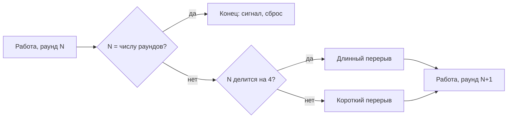
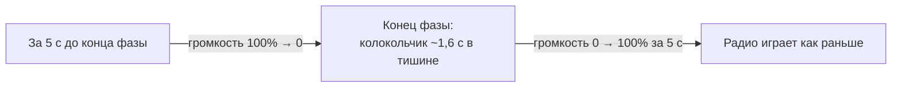

# Таймер

Виджет в правом верхнем углу (на телефоне — сверху во всю ширину, под обоями). Три режима на вкладках: **Помидоро**, **Отсчёт** и **Секундомер**. Положение задаёт [`src/App.tsx`](../src/App.tsx), всё остальное лежит в `src/widgets/timer/`.

## Где код

| Файл                                                                            | Что внутри                                                                                         |
| ------------------------------------------------------------------------------- | -------------------------------------------------------------------------------------------------- |
| [`src/widgets/timer/TimerWidget.tsx`](../src/widgets/timer/TimerWidget.tsx)     | Разметка: вкладки, настройки, циферблат и кнопки. Логики нет, только вызов `useTimer`              |
| [`src/widgets/timer/useTimer.ts`](../src/widgets/timer/useTimer.ts)             | Вся логика: настройки, запуск, пауза, смена фаз, догон после перезагрузки, `localStorage`          |
| [`src/widgets/timer/SettingSlider.tsx`](../src/widgets/timer/SettingSlider.tsx) | Строка настройки во всю ширину на Base UI Slider: заливка фона показывает значение                 |
| [`src/widgets/timer/signal.ts`](../src/widgets/timer/signal.ts)                 | Сигнал о конце фазы: колокольчик через Web Audio и системное уведомление                           |
| [`src/lib/ducking.ts`](../src/lib/ducking.ts)                                   | Приглушение музыки вокруг сигнала: таймер сообщает момент сигнала, радио берёт множитель громкости |
| [`src/hooks/useDuckLevel.ts`](../src/hooks/useDuckLevel.ts)                     | Хук для звуковых виджетов: текущий множитель громкости, тикает только во время приглушения         |
| [`src/components/ui/tabs.tsx`](../src/components/ui/tabs.tsx)                   | Вкладки base-nova на Base UI в стиле стеклянной панели                                             |
| [`src/components/ui/progress.tsx`](../src/components/ui/progress.tsx)           | Полоса прогресса base-nova на Base UI в стиле стеклянной панели                                    |

## Режимы

| Режим      | Настройки                                                         | Что происходит в конце                      |
| ---------- | ----------------------------------------------------------------- | ------------------------------------------- |
| Помидоро   | Работа 5–90 мин, короткий перерыв 1–30, длинный 5–60, раунды 1–12 | Следующая фаза стартует сама, звучит сигнал |
| Отсчёт     | Длительность 1–180 мин                                            | Сигнал, таймер сбрасывается                 |
| Секундомер | Нет                                                               | Не заканчивается, только «Сбросить»         |

По умолчанию: 25 / 5 / 15 минут, 4 раунда, отсчёт 10 минут.

### Порядок фаз помидоро

- После последнего раунда перерыва нет. Поэтому подпись «Всего» под настройками — это все раунды плюс перерывы **между** ними (`pomodoroTotal`).
- Длинный перерыв идёт после каждого 4-го раунда (`longBreakEvery`). Отдельной настройки для этого нет.

## Кнопки

| Кнопка                     | Где                              | Что делает                                                                                   |
| -------------------------- | -------------------------------- | -------------------------------------------------------------------------------------------- |
| Колокольчик                | Справа от подписи                | Включает и выключает звуковой сигнал. Уведомления от него не зависят                         |
| Старт                      | Под настройками                  | Запускает таймер выбранного режима, просит разрешение на уведомления                         |
| Пауза / Продолжить         | Под циферблатом                  | Пауза и продолжение                                                                          |
| Сбросить (`RotateCcw`)     | Слева от паузы                   | Останавливает таймер и возвращает к настройкам                                               |
| Пропустить (`SkipForward`) | Справа от паузы, только Pomodoro | Следующая фаза без сигнала. Если таймер шёл, она сразу идёт. После последнего раунда — сброс |

У каждой вкладки свой таймер. Пока таймер **идёт**, другие вкладки недоступны: одновременно идёт только один. Если поставить его **на паузу**, можно перейти на другую вкладку, запустить там свой таймер и потом вернуться: приостановленный таймер ждёт на своей вкладке. Такие вкладки отмечены точкой справа от названия.

Пока у вкладки есть таймер (идёт или на паузе), её настройки скрыты, поэтому поменять длительность посреди фазы нельзя.

## Как считается время

Время считается не тиками, а по меткам `Date.now()`:

Таймеры хранятся по режимам: `runs: { pomodoro?, countdown?, stopwatch? }`. Текущий режим — это режим идущего таймера, если он есть, иначе выбранная вкладка (`settings.mode`).

| Поле `TimerRun`  | Что                                                   |
| ---------------- | ----------------------------------------------------- |
| `startedAt`      | Когда таймер последний раз запущен; `null` — на паузе |
| `elapsed`        | Сколько мс набежало до этого запуска                  |
| `duration`       | Длительность текущей фазы в мс, у секундомера `null`  |
| `phase`, `round` | Фаза помидоро и номер раунда                          |

Прошло времени = `elapsed + (now − startedAt)`. Интервал в 250 мс только перерисовывает циферблат. Поэтому таймер не отстаёт в фоновой вкладке и переживает перезагрузку.

**Догон после перезагрузки.** Если вкладка была закрыта дольше, чем осталось фазе, `settle` проходит все пропущенные фазы. Каждая следующая начинается ровно в момент конца предыдущей. Сигнал при этом звучит один раз.

## Сигнал и уведомления

- **Звук** — три ноты через Web Audio, файлов нет. Играет поверх радио. `AudioContext` создаётся по нажатию «Старт» или «Продолжить»: без клика браузер звук не пустит. Поэтому после перезагрузки страницы первый сигнал может не прозвучать, пока пользователь не нажмёт что-нибудь в таймере.
- **Уведомление** показывается, только если вкладку не видно (`document.hidden`). Разрешение спрашивается при первом «Старт». Если пользователь отказал, остаётся только звук.
- **Задержка в фоне.** Chrome сильно замедляет таймеры в скрытых вкладках, где ничего не играет: сигнал и уведомление могут опоздать до минуты. Само время при этом считается верно. Если играет радио, вкладка не замедляется.

## Приглушение музыки

Если сигнал включён, радио затихает вокруг него, а потом возвращается само:

- Таймер не знает про радио, а радио — про таймер. Связь через [`src/lib/ducking.ts`](../src/lib/ducking.ts): `useTimer` сообщает момент сигнала (`duckBefore`) и после колокольчика просит вернуть звук (`restoreAfter`). `useRadio` берёт множитель через `useDuckLevel` и ставит `audio.volume = volume × множитель`.
- Слайдер громкости радио при этом не двигается: он показывает громкость пользователя, а не текущую.
- Без звукового сигнала, на паузе и в секундомере момента сигнала нет, и музыка не затихает. Если поставить паузу посреди затухания, громкость сразу возвращается.
- «Пропустить фазу» подаёт сигнал без звука, поэтому музыка тоже не затихает.
- Новому звуковому виджету достаточно так же умножить громкость на `useDuckLevel()`.

## Что лежит в localStorage

| Ключ                   | Что                                                             | Когда пишется                                       |
| ---------------------- | --------------------------------------------------------------- | --------------------------------------------------- |
| `tempo:timer-settings` | Режим (вкладка), длительности, число раундов, звук вкл/выкл     | При любом изменении                                 |
| `tempo:timer-runs`     | Таймеры по режимам: идущий и поставленные на паузу (`TimerRun`) | При любом изменении. Удаляется при сбросе и в конце |
