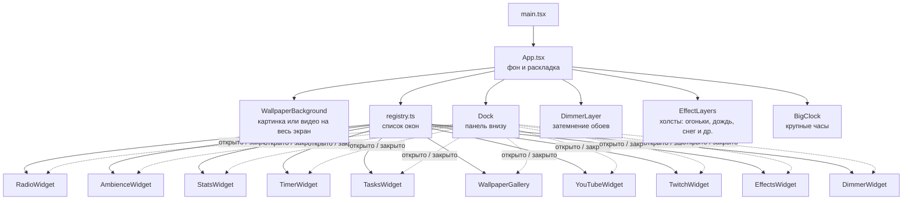

# Виджеты

Страница — это полноэкранные обои, поверх которых стоят независимые виджеты в окнах. Окна открываются и закрываются кнопками [панели](#панель) внизу экрана. Каждый виджет живёт в своей папке в `src/widgets/` и сам отвечает за свою логику и разметку. Какие окна есть, где они стоят и в какой группе панели их кнопка, описано в одном месте — в реестре [`src/widgets/registry.ts`](../src/widgets/registry.ts). `App.tsx` только раскладывает по нему страницу.

## Как устроена страница



Слои снизу вверх: обои → затемнение (`DimmerLayer`) → крупные часы посередине (`z-[5]`) → окна виджетов (`z-10`) → панель (`z-20`) → эффекты (`EffectCanvas`, `z-50`, не перехватывают клики). Тени облаков — исключение: они между обоями и окнами (`z-[1]`).

## Список виджетов

| Виджет             | Что делает                                                                                                                                                            |
| ------------------ | --------------------------------------------------------------------------------------------------------------------------------------------------------------------- |
| `RadioWidget`      | Интернет-радио: страны, станции, громкость, избранное. Подробно в [radio.md](radio.md)                                                                                |
| `AmbienceWidget`   | Микшер фоновых звуков: камин, дождь, ветер, шумы. Играет поверх радио. Подробно в [ambience.md](ambience.md)                                                          |
| `StatsWidget`      | Статистика: сколько людей сейчас на сайте, серия дней с заходом и время на сайте. Подробно в [stats.md](stats.md)                                                     |
| `TimerWidget`      | Помидоро, обратный отсчёт и секундомер. Перед сигналом приглушает радио и звуки. Подробно в [timer.md](timer.md)                                                      |
| `TasksWidget`      | Доска задач «Сделать / В работе / Готово» с перетаскиванием карточек. Подробно в [tasks.md](tasks.md)                                                                 |
| `WallpaperGallery` | Галерея файловых обоев по категориям с прокруткой. Клик по превью меняет фон. Видео-обои помечены ▶. Подробно в [wallpaper.md](wallpaper.md)                          |
| `YouTubeWidget`    | Видео или стрим с YouTube как фон: поле для ссылки, «Мои видео» и подборки стримов. Подробно в [youtube.md](youtube.md)                                               |
| `TwitchWidget`     | Окно-плеер Twitch: канал на видимом плеере 16:9, ссылка и тема «Музыка». Не фон. Подробно в [twitch.md](twitch.md)                                                    |
| `EffectsWidget`    | Включение эффектов поверх страницы: огоньки, дождь, ливень, снег, листья, сакура, светлячки, тени облаков. Можно несколько сразу. Подробно в [effects.md](effects.md) |
| `DimmerWidget`     | Ползунок затемнения обоев 0–90 %. Подробно в [dimmer.md](dimmer.md)                                                                                                   |
| `Dock`             | Не окно, а панель с кнопками окон. Подробно в разделе [Панель](#панель)                                                                                               |

Порядок строк — порядок в `definitions` в реестре: он же задаёт порядок кнопок в группе панели и окон в столбце. Кроме окон, есть части страницы без своего окна: [сцены и первый экран](scenes.md), [режим фокуса и крупные часы](focus.md), [горячие клавиши](hotkeys.md).

`EffectCanvas` — не окно, а холст на весь экран поверх страницы, по одному на каждый включённый эффект. Включаются они в окне `EffectsWidget`. Так же `DimmerLayer` — слой затемнения на весь экран под эффектами, им управляет `DimmerWidget`.

## Общие части

Перед тем как писать своё, посмотри, нет ли готового: «стеклянная» оболочка окна `Widget` с `WidgetHeader` и `WidgetTitle`, хранилище (`src/lib/storage.ts`, `usePersistentState`), медиазапросы (`mediaQueries` и `useMediaQuery`, для кода вне React — `matchesMedia`), один `AudioContext` на страницу (`src/lib/audio.ts`; `unlockAudio()` вызывать прямо в обработчике клика), запуск `<audio>` после первого клика (`useAutoplay`), полоса прокрутки `scrollbar-glass` и компоненты Base UI в `src/components/ui/`.

## Правила для виджетов

Сами правила в коротком виде — в разделе «Widgets» [AGENTS.md](../AGENTS.md): он один для людей и агентов, здесь правила не повторяются. Ниже — почему они такие.

- **Положение задаёт реестр, а не виджет.** Место и ширину окна задают `column`, `anchor`, `placement` и `slot` в `registry.ts`, общие классы окна — `windowClass` в `App.tsx`. Так окно можно передвинуть или поставить на место другого, не трогая его код.
- **Логика — в модулях без React.** Компонент вызывает хук `use<Имя>.ts` и рисует, а решения, которые стоит проверить, лежат в чистых модулях: тесты идут в Node, без браузера.
- **В общие `src/hooks/` и `src/lib/` выносится только то, что нужно двум виджетам и больше.** Например, клиент API «Рекорда» — `src/widgets/radio/recordApi.ts`, а не в `lib/`.
- **Громкость каждого звука умножается на `useDuckLevel()`.** Каждый звуковой виджет управляет своим звуком сам, но через этот множитель все звуки затихают вокруг сигнала таймера и глохнут разом в режиме [«Без звука»](#без-звука-и-без-эффектов).
- **Сохранённое значение всегда проходит через `parse`.** В `localStorage` может лежать что угодно: старый формат, испорченные данные. `parse` проверяет данные и переводит старые форматы, а `undefined` означает «взять значение по умолчанию». Иначе посетитель с прошлой версии получит ошибку или молча потеряет настройки. Ошибки самого хранилища (приватный режим) уже обработаны внутри. Что выбрать:
  - состояние одного хука — `usePersistentState(key, fallback, parse)`, как `useState`;
  - состояние нескольких компонентов — `createPersistentStore` и `useSyncExternalStore(store.subscribe, store.get)`, как в `useWallpaper` (фон и галерея) и `useActiveEffects` (окно и холсты);
  - разовое чтение или запись — `loadStored` и `saveStored`, как последняя станция в `useRadio`.
- **Закрытое окно скрыто, а не удалено** (класс `hidden`): радио и звуки продолжают играть, таймер — идти. Поэтому виджет не полагается на то, что его видно, и сам останавливает то, что без окна не нужно.

## Панель

`Dock` — это три панели внизу экрана: «Звук» в левом нижнем углу под радио, «Главное» снизу по центру и «Вид» в правом нижнем углу. Панели и их группы описаны в `dockPanels`, а кнопки окон попадают в группу из реестра по полю `dockGroup`. Подсвеченная кнопка — окно открыто. После кнопок окон в группе может идти своя кнопка (поле `extra`): в «Звуке» — звуки нажатий (клавиша `K`), в «Главном» — крупные часы (клавиша `C`, см. [focus.md](focus.md)), в «Виде» — «Сменить сцену» (клавиша `S`, см. [scenes.md](scenes.md)). У кнопок окон есть клавиши `1`–`0` и подсказки с ними, см. [hotkeys.md](hotkeys.md).

Порядок кнопок в группе и их клавиши задаёт реестр (`dockGroup` и `hotkey`), все клавиши перечислены в [hotkeys.md](hotkeys.md).

Полный экран, «Фокус», «Без звука», «Без эффектов» и список клавиш — не в панели, а в правом верхнем углу. «Фокус» описан в [focus.md](focus.md).

- **Звуки нажатий** — тихие тики при нажатии кнопок. Синтезируются через Web Audio, без файлов, одним слушателем на весь документ (`src/lib/clickSound.ts`), поэтому кнопкам ничего подключать не нужно. По умолчанию включены, выбор хранится в `tempo:click-sounds`. В режиме «Без звука» молчат.
- **Открытые окна** — массив id в порядке открытия, последнее открытое в конце. Хранится в `tempo:open-widgets`.
- **При первом заходе** открыты обои, таймер и радио, остальные окна закрыты (`defaultOpen` в `useDock.ts`). Поверх них новому посетителю показываются [сцены](scenes.md).
- **На узком экране** (меньше `xl`, 1280px; `mediaQueries.singleWindow`) видно только одно окно — последнее открытое. Новое окно заменяет текущее. На телефоне панели стоят столбиком у левого края (`dockRowClass` в `App.tsx`), с `sm` — каждая в своём углу.
- **Окна одного `slot`** на широком экране заменяют друг друга: открытие одного закрывает соседей по месту (`openWindow`). Если в сохранённом списке соседи оказались открыты вместе, при чтении остаётся последнее открытое (`parseOpen`).
- **Закрытое окно скрывается, а не удаляется**: `App.tsx` добавляет ему класс `hidden`. Поэтому радио и звуки продолжают играть с закрытым окном. См. [правила для виджетов](#правила-для-виджетов).

## Без звука и без эффектов

В правом верхнем углу перед «Фокусом» две круглые кнопки. Обе — переключатели (`aria-pressed`): включённый режим подсвечен, повторное нажатие возвращает всё как было. Состояние сохраняется между визитами. Кнопки видны и в режиме фокуса ([focus.md](focus.md)).

- **Без звука** (динамик, клавиша `M`) — глушит весь звук сайта: радио, фоновые звуки, звук YouTube и Twitch, сигнал таймера и тики нажатий. Ничего не останавливается и не выключается: радио и звуки продолжают «играть» беззвучно, громкость и настройки каждого виджета не меняются. Поэтому после второго нажатия звучит ровно то, что звучало. Если сайт открыт в режиме «без звука», ничего не зазвучит само.
  - Флаг — `soundMutedStore` в [`src/lib/soundMute.ts`](../src/lib/soundMute.ts), ключ `tempo:sound-muted`.
  - Радио, звуки, YouTube и Twitch берут громкость через [`useDuckLevel`](../src/hooks/useDuckLevel.ts): в режиме «без звука» множитель всегда 0 (`audibleLevel`). При нулевом множителе радио, YouTube и Twitch ещё и ставят `muted` (на iPhone громкость медиа не меняется, работает только mute; `audioTarget` в `src/widgets/youtube/playback.ts`).
  - Короткие звуки Web Audio сами спрашивают `isSoundMuted()`: `playClick` ([`src/lib/clickSound.ts`](../src/lib/clickSound.ts)) и `playChime` ([`src/widgets/timer/signal.ts`](../src/widgets/timer/signal.ts)). Уведомление таймера приходит как обычно.
  - Новый источник звука: умножай громкость на `useDuckLevel()` или проверяй `isSoundMuted()` перед запуском.
- **Без эффектов** (искры, клавиша `E`) — прячет всё, что рисуется поверх обоев: частицы ([эффекты](effects.md)) и [затемнение](dimmer.md). Обои, видео-обои, YouTube-фон остаются: это сам фон, а не эффект. Выбранные эффекты, их пауза и уровень затемнения не меняются. Пока режим включён, окна эффектов и затемнения показывают строку «Эффекты скрыты» с кнопкой «Показать».
  - Флаг — `effectsOffStore` в [`src/widgets/effects/effectsOff.ts`](../src/widgets/effects/effectsOff.ts), ключ `tempo:effects-off`.
  - `EffectLayers` и `DimmerLayer` в этом режиме ничего не рисуют: холсты удаляются вместе с циклами отрисовки.
  - Новый слой-эффект поверх обоев: проверяй `useEffectsOff()` и не рисуй его, когда режим включён.

## Раскладка на разных экранах

Брейкпоинты Tailwind: `sm` — от 640px, `lg` — от 1024px, `xl` — от 1280px. С 640px окна стоят в трёх столбцах (`columns` и `columnClass` в `App.tsx`): левом, центральном и правом. Окно попадает в столбец по полю `column` в `registry.ts`, прижимается к верху или к низу по полю `anchor`, ширина и прочее — в `placement`. Общие для всех окон классы — `windowClass` в `App.tsx`.

| Ширина экрана | Что на экране                                                                                                                                                                                                                                                                     |
| ------------- | --------------------------------------------------------------------------------------------------------------------------------------------------------------------------------------------------------------------------------------------------------------------------------- |
| до 640px      | Одно окно над панелью во всю ширину, не выше экрана, с прокруткой                                                                                                                                                                                                                 |
| 640–1279px    | Одно окно (последнее открытое) в своём столбце: левый у левого края, центральный по центру, правый у правого края. Столбцы абсолютные, отступ сверху 4rem — ниже логотипа и кнопок в углах                                                                                        |
| от 1280px     | Все открытые окна сразу. Столбцы — три колонки сетки: две боковые равной ширины и центральная 28rem (`gridClass`), поэтому центр стоит по середине экрана. Боковые окна тянутся по колонке (`xl:w-full`) и не шире потолка из `placement`, поэтому окна не наезжают друг на друга |

- **Панели** — в левом нижнем углу («Звук»), снизу («Главное») и в правом нижнем углу («Вид»), отступ 1rem, от 1024px — 2rem. От `sm` до `md` панель «Главное» стоит сразу справа от «Звука», с `md` — по центру.
- **Столбцы кончаются над панелью**: от 640px — `bottom-24`, а сетка с `xl` — `bottom-28`, поэтому нижние окна не наезжают на кнопки.
- **Верхний отступ с `xl`** у каждого столбца свой: левый ниже логотипа, правый ниже кнопки полного экрана, центральный начинается выше.
- **Окна одного столбца не перекрываются.** Верхние окна (`anchor: 'top'`) прижаты к верху, нижние — к низу, между ними зазор 1rem. Если закрыть верхнее окно, нижнее остаётся внизу. Если окнам не хватает высоты, сжимаются окна без `sm:shrink-0` (содержимое прокручивается внутри), а окна с `sm:shrink-0` — радио и таймер — остаются целиком. Поэтому длинный список звуков прокручивается над радио, а задачи сжимаются под таймером или статистикой. Подбирать `max-h` под соседей не нужно.
- **Левый столбец** — звуки сверху, радио снизу. **Центральный** — свёрнутые [крупные часы](focus.md#крупные-часы) (если включены), статистика или таймер сверху, задачи снизу. **Правый** — одно окно слота `view`.
- **На телефоне столбцов нет** (`contents`), окна встают по общему `windowClass`: над панелью, во всю ширину с полями 1rem, не выше экрана, с прокруткой.
- **Обои, YouTube, Twitch, эффекты и затемнение стоят на одном месте** и открываются по очереди: открытие одного окна закрывает другое (одинаковый `slot` в `registry.ts`). Статистика и таймер тоже делят место (`center-top`). У задач слота нет, они открываются вместе со статистикой или таймером.
- Таймер растёт вниз, когда меняет высоту (другая вкладка, запуск), и тогда задачи под ним становятся ниже.
- В [режиме фокуса](focus.md) окна и панели скрыты, но остаются на странице.

## Как добавить виджет

Порядок шагов — в разделе «Widgets» [AGENTS.md](../AGENTS.md). Здесь — заготовки.

Окно:

```tsx
import { cn } from '@/lib/utils';
import { Widget, WidgetHeader } from '@/widgets/Widget';

type ClockWidgetProps = {
	className?: string;
};

export function ClockWidget({ className }: ClockWidgetProps) {
	return (
		<Widget aria-label="Часы" className={cn('flex flex-col gap-1.5 p-4', className)}>
			<WidgetHeader title="Часы" />
			{/* содержимое виджета */}
		</Widget>
	);
}
```

Запись в `definitions` в [`src/widgets/registry.ts`](../src/widgets/registry.ts). `WidgetId`, кнопка на панели и окно на странице появятся сами:

```ts
{
	id: 'clock',
	label: 'Часы',
	icon: Clock,
	dockGroup: 'main',
	component: ClockWidget,
	column: 'center',
	anchor: 'bottom',
	placement: 'sm:w-[18rem] xl:w-full xl:max-w-[18rem]'
}
```
