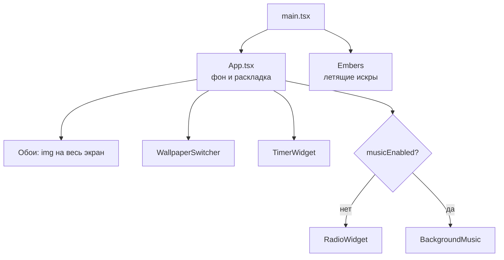

# Виджеты

Страница — это полноэкранные обои, поверх которых стоят независимые виджеты. Каждый виджет живёт в своей папке в `src/widgets/` и сам отвечает за свою логику и разметку. `App.tsx` только решает, какие виджеты показать и где на экране.

## Как устроена страница



Слои снизу вверх: обои → виджеты (`z-10`) → искры (`Embers`, `z-50`, не перехватывают клики).

## Список виджетов

| Виджет              | Папка                                                 | Где на экране      | Что делает                                                                                               |
| ------------------- | ----------------------------------------------------- | ------------------ | -------------------------------------------------------------------------------------------------------- |
| `TimerWidget`       | [`src/widgets/timer/`](../src/widgets/timer/)         | Над радио          | Помидоро, обратный отсчёт и секундомер. Перед сигналом приглушает радио. Подробно в [timer.md](timer.md) |
| `RadioWidget`       | [`src/widgets/radio/`](../src/widgets/radio/)         | Правый нижний угол | Интернет-радио: страны, станции, громкость, избранное. Подробно в [radio.md](radio.md)                   |
| `WallpaperSwitcher` | [`src/widgets/wallpaper/`](../src/widgets/wallpaper/) | Левый нижний угол  | Кнопки «предыдущие / следующие обои». Список обоев — `wallpapers.ts`                                     |
| `BackgroundMusic`   | [`src/widgets/music/`](../src/widgets/music/)         | Не видна           | Загруженные треки по кругу. **Сейчас скрыта** флагом `musicEnabled` в `App.tsx`                          |

`Embers` (`src/components/Embers.tsx`) — не виджет, а декоративный эффект поверх всей страницы. Он подключается в `main.tsx`.

## Общие части

| Что                                                       | Зачем                                                                                                                             |
| --------------------------------------------------------- | --------------------------------------------------------------------------------------------------------------------------------- |
| [`src/widgets/Widget.tsx`](../src/widgets/Widget.tsx)     | «Стеклянная» оболочка: полупрозрачный тёмный фон, размытие, рамка, тень, `z-10`. Рендерит `<section>`, принимает все его свойства |
| [`src/hooks/useAutoplay.ts`](../src/hooks/useAutoplay.ts) | Запуск звука в `<audio>`. Если браузер заблокировал автозапуск, ждёт первого клика или нажатия клавиши                            |
| [`src/components/ui/`](../src/components/ui/)             | Кнопка, комбобокс, слайдер, вкладки, прогресс. Всё, кроме кнопки, — на Base UI в стиле стеклянной панели                          |

## Правила для виджетов

1. **Положение задаёт `App.tsx`, а не виджет.** Виджет принимает `className` и передаёт его в `<Widget>`. Классы `absolute`, отступы и ширину по брейкпоинтам пишет тот, кто ставит виджет на страницу. Так виджет можно передвинуть, не трогая его код.
2. **Логика — в хуке, разметка — в компоненте.** Если состояния больше пары `useState`, оно уходит в `useИмяВиджета.ts` рядом с компонентом, как `useRadio`. Компонент только вызывает хук и рисует.
3. **Свои данные и API лежат в папке виджета.** Например, клиент Radio Browser — `src/widgets/radio/api.ts`, а не в общем `lib/`. В общие `src/hooks/` и `src/lib/` выносится только то, что нужно двум виджетам и больше.
4. **Каждый звуковой виджет владеет своим `<audio>`** и запускает его через `useAutoplay`. Громкость он умножает на `useDuckLevel()`, чтобы затихать вокруг сигнала таймера. Одновременно должен играть только один источник звука: сейчас это обеспечивает `musicEnabled` в `App.tsx`.
5. **Сохранение в браузере — с префиксом `tempo:`** и в `try/catch`: в приватном режиме `localStorage` может быть недоступен. Сейчас используются ключи `tempo:favorite-stations`, `tempo:last-station`, `tempo:timer-settings` и `tempo:timer-runs`.
6. **Подпись и кнопки — в общем стиле.** Мелкая подпись виджета — `text-xs font-medium text-white/60`, кнопки — `Button variant="ghost"` с белым текстом и подсветкой `hover:bg-white/15`. У каждой кнопки с иконкой есть `title` и `aria-label` на русском.

## Раскладка на разных экранах

Брейкпоинты Tailwind: `sm` — от 640px, `lg` — от 1024px.

| Ширина экрана | Таймер и радио                                | Обои                           |
| ------------- | --------------------------------------------- | ------------------------------ |
| до 640px      | Снизу во всю ширину, отступы 1rem             | Левый **верхний** угол         |
| 640–1024px    | Правый нижний угол, ширина 26rem, отступ 1rem | Левый нижний угол, отступ 1rem |
| от 1024px     | Правый нижний угол, отступ 2rem               | Левый нижний угол, отступ 2rem |

Таймер и радио стоят в одной колонке (`flex flex-col gap-3` в `App.tsx`): таймер сверху, радио снизу. Колонка прижата к низу, поэтому, когда таймер меняет высоту (другая вкладка, запуск), он растёт вверх, а радио остаётся на месте.

На телефоне обои уходят наверх, потому что колонка занимает всю нижнюю часть. Новый виджет нужно проверить на всех трёх ширинах, чтобы он не наезжал на соседей.

## Как добавить виджет

1. Создай папку `src/widgets/<имя>/` и компонент в ней:

   ```tsx
   import { cn } from '@/lib/utils';
   import { Widget } from '@/widgets/Widget';

   type ClockWidgetProps = {
   	className?: string;
   };

   export function ClockWidget({ className }: ClockWidgetProps) {
   	return (
   		<Widget aria-label="Часы" className={cn('flex flex-col gap-1.5 p-4', className)}>
   			<span className="text-xs font-medium text-white/60">Clock</span>
   			{/* содержимое виджета */}
   		</Widget>
   	);
   }
   ```

2. Если логики много, вынеси её в `use<Имя>.ts` в той же папке.
3. Поставь виджет на страницу в `App.tsx` и задай положение через `className`, например `className="absolute top-4 right-4 lg:top-8 lg:right-8"`.
4. Проверь раскладку на ширинах до 640px, 640–1024px и от 1024px.
5. Добавь строку в [список виджетов](#список-виджетов). Если у виджета есть неочевидная логика, заведи для него отдельный файл в `docs/`, как [radio.md](radio.md), и добавь ссылку в README.
