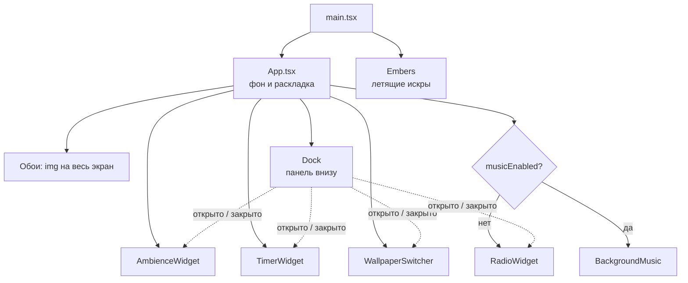

# Виджеты

Страница — это полноэкранные обои, поверх которых стоят независимые виджеты в окнах. Окна открываются и закрываются кнопками [панели](#панель) внизу экрана. Каждый виджет живёт в своей папке в `src/widgets/` и сам отвечает за свою логику и разметку. `App.tsx` только решает, какие виджеты показать и где на экране.

## Как устроена страница



Слои снизу вверх: обои → окна виджетов (`z-10`) → панель (`z-20`) → искры (`Embers`, `z-50`, не перехватывают клики).

## Список виджетов

| Виджет              | Папка                                                 | Где на экране       | Что делает                                                                                                       |
| ------------------- | ----------------------------------------------------- | ------------------- | ---------------------------------------------------------------------------------------------------------------- |
| `AmbienceWidget`    | [`src/widgets/ambience/`](../src/widgets/ambience/)   | Левый верхний угол  | Микшер фоновых звуков: камин, дождь, ветер, шумы. Играет поверх радио. Подробно в [ambience.md](ambience.md)     |
| `TimerWidget`       | [`src/widgets/timer/`](../src/widgets/timer/)         | Правый верхний угол | Помидоро, обратный отсчёт и секундомер. Перед сигналом приглушает радио и звуки. Подробно в [timer.md](timer.md) |
| `RadioWidget`       | [`src/widgets/radio/`](../src/widgets/radio/)         | Правый нижний угол  | Интернет-радио: страны, станции, громкость, избранное. Подробно в [radio.md](radio.md)                           |
| `WallpaperSwitcher` | [`src/widgets/wallpaper/`](../src/widgets/wallpaper/) | Левый нижний угол   | Выбор фракции (Альянс / Орда) и листание её обоев. Список — `wallpapers.ts`, состояние — `useWallpaper.ts`       |
| `BackgroundMusic`   | [`src/widgets/music/`](../src/widgets/music/)         | Не видна            | Загруженные треки по кругу. **Сейчас скрыта** флагом `musicEnabled` в `App.tsx`                                  |
| `Dock`              | [`src/widgets/dock/`](../src/widgets/dock/)           | Снизу по центру     | Не окно, а панель с кнопками окон. Подробно в разделе [Панель](#панель)                                          |

`Embers` (`src/components/Embers.tsx`) — не виджет, а декоративный эффект поверх всей страницы. Он подключается в `main.tsx`.

## Общие части

| Что                                                       | Зачем                                                                                                                             |
| --------------------------------------------------------- | --------------------------------------------------------------------------------------------------------------------------------- |
| [`src/widgets/Widget.tsx`](../src/widgets/Widget.tsx)     | «Стеклянная» оболочка: полупрозрачный тёмный фон, размытие, рамка, тень, `z-10`. Рендерит `<section>`, принимает все его свойства |
| [`src/hooks/useAutoplay.ts`](../src/hooks/useAutoplay.ts) | Запуск звука в `<audio>`. Если браузер заблокировал автозапуск, ждёт первого клика или нажатия клавиши                            |
| [`src/components/ui/`](../src/components/ui/)             | Кнопка, комбобокс, слайдер, вкладки, прогресс. Всё, кроме кнопки, — на Base UI в стиле стеклянной панели                          |

## Правила для виджетов

1. **Положение задаёт `App.tsx`, а не виджет.** Виджет принимает `className` и передаёт его в `<Widget>`. Классы `absolute`, отступы и ширину по брейкпоинтам пишет тот, кто ставит виджет на страницу. Так виджет можно передвинуть, не трогая его код.
2. **Логика — в хуке, разметка — в компоненте.** Если состояния больше пары `useState`, оно уходит в `useИмяВиджета.ts` рядом с компонентом, как `useRadio`. Компонент только вызывает хук и рисует.
3. **Свои данные и API лежат в папке виджета.** Например, клиент Radio Browser — `src/widgets/radio/api.ts`, а не в общем `lib/`. В общие `src/hooks/` и `src/lib/` выносится только то, что нужно двум виджетам и больше.
4. **Каждый звуковой виджет управляет своим звуком сам.** Радио и музыка владеют своим `<audio>` и запускают его через `useAutoplay`, звуки — своим движком на Web Audio (`src/lib/ambience.ts`). Громкость все умножают на `useDuckLevel()`, чтобы затихать вокруг сигнала таймера. Музыка и радио взаимоисключающие (`musicEnabled` в `App.tsx`), а звуки рассчитаны на то, чтобы играть поверх них.
5. **Сохранение в браузере — с префиксом `tempo:`** и в `try/catch`: в приватном режиме `localStorage` может быть недоступен. Сейчас используются ключи `tempo:ambience`, `tempo:favorite-stations`, `tempo:last-station`, `tempo:open-widgets`, `tempo:timer-settings`, `tempo:timer-runs` и `tempo:wallpaper`.
6. **Подпись и кнопки — в общем стиле.** Мелкая подпись виджета — `text-xs font-medium text-white/60`, кнопки — `Button variant="ghost"` с белым текстом и подсветкой `hover:bg-white/15`. У каждой кнопки с иконкой есть `title` и `aria-label` на русском.
7. **Виджет должен работать, когда его окно закрыто.** Закрытое окно не удаляется со страницы, а скрывается классом `hidden`: радио и звуки продолжают играть, таймер — идти. Не полагайся на то, что виджет видим.

## Панель

`Dock` стоит внизу экрана по центру. Его кнопки, сгруппированные по смыслу, открывают и закрывают окна виджетов. Подсвеченная кнопка — окно открыто.

| Группа | Кнопка | Окно                |
| ------ | ------ | ------------------- |
| Звук   | Радио  | `RadioWidget`       |
| Звук   | Звуки  | `AmbienceWidget`    |
| Фокус  | Таймер | `TimerWidget`       |
| Вид    | Обои   | `WallpaperSwitcher` |

| Файл                                                            | Что внутри                                                                                 |
| --------------------------------------------------------------- | ------------------------------------------------------------------------------------------ |
| [`src/widgets/dock/Dock.tsx`](../src/widgets/dock/Dock.tsx)     | Разметка панели и список групп с кнопками (`groups`)                                       |
| [`src/widgets/dock/useDock.ts`](../src/widgets/dock/useDock.ts) | Какие окна открыты, `isOpen` и `toggle`, сохранение в `localStorage`, определение телефона |

- **Открытые окна** — массив id в порядке открытия, последнее открытое в конце. Хранится в `tempo:open-widgets`.
- **При первом заходе** открыты обои, таймер и радио, звуки закрыты (`defaultOpen`).
- **На телефоне** (уже 640px) видно только одно окно — последнее открытое. Новое окно заменяет текущее. Подписи групп на телефоне скрыты, чтобы панель поместилась.
- **Закрытое окно скрывается, а не удаляется**: `App.tsx` добавляет ему класс `hidden`. Поэтому радио и звуки продолжают играть с закрытым окном. См. [правило 7](#правила-для-виджетов).

## Раскладка на разных экранах

Брейкпоинты Tailwind: `sm` — от 640px, `lg` — от 1024px. Классы положения лежат в `App.tsx`: `windowClass` — общие для всех окон, `windowPlacement` — у каждого окна свои.

| Ширина экрана | Звуки                                         | Таймер                                         | Радио                                 | Обои                          |
| ------------- | --------------------------------------------- | ---------------------------------------------- | ------------------------------------- | ----------------------------- |
| до 640px      | Над панелью во всю ширину                     | Над панелью во всю ширину                      | Над панелью во всю ширину             | Над панелью во всю ширину     |
| 640–1024px    | Левый верхний угол, ширина 22rem, отступ 1rem | Правый верхний угол, ширина 26rem, отступ 1rem | Правый нижний угол над панелью, 26rem | Левый нижний угол над панелью |
| от 1024px     | То же, отступ 2rem                            | То же, отступ 2rem                             | То же, отступ 2rem                    | То же, отступ 2rem            |

- **Панель** — снизу по центру, отступ 1rem, от 1024px — 2rem.
- **Нижние окна стоят над панелью**: `bottom-24` (от 1024px — `bottom-28`), чтобы панель не наезжала на радио и обои на узких экранах.
- **Окно не выше экрана.** У всех окон есть `max-h` и `overflow-y-auto`: если содержимое не влезает, оно прокручивается внутри окна. У звуков высота ограничена сильнее, чтобы они не наезжали на окно обоев в том же левом столбце.
- Таймер прижат к верху, поэтому, когда он меняет высоту (другая вкладка, запуск), он растёт вниз, к радио.

## Как добавить виджет

1. Создай папку `src/widgets/<имя>/` и компонент в ней:

   ```tsx
   import { cn } from '@/lib/utils';
   import { Widget } from '@/widgets/Widget';

   type ClockWidgetProps = {
   	className?: string;
   };

   export function ClockWidget({ className }: ClockWidgetProps) {
   	return (
   		<Widget aria-label="Часы" className={cn('flex flex-col gap-1.5 p-4', className)}>
   			<span className="text-xs font-medium text-white/60">Clock</span>
   			{/* содержимое виджета */}
   		</Widget>
   	);
   }
   ```

2. Если логики много, вынеси её в `use<Имя>.ts` в той же папке.
3. Добавь id в `WidgetId` в [`useDock.ts`](../src/widgets/dock/useDock.ts) и кнопку в нужную группу `groups` в [`Dock.tsx`](../src/widgets/dock/Dock.tsx). Если окно должно быть открыто при первом заходе, добавь id в `defaultOpen`.
4. Поставь виджет на страницу в `App.tsx` с `className={placement('<id>')}` и опиши его угол в `windowPlacement`, например `'sm:top-4 sm:bottom-auto sm:left-4 lg:top-8 lg:left-8'`. Положение на телефоне уже задано общим `windowClass`.
5. Проверь раскладку на ширинах до 640px, 640–1024px и от 1024px.
6. Добавь строку в [список виджетов](#список-виджетов) и в таблицу [панели](#панель). Если у виджета есть неочевидная логика, заведи для него отдельный файл в `docs/`, как [radio.md](radio.md), и добавь ссылку в README.
