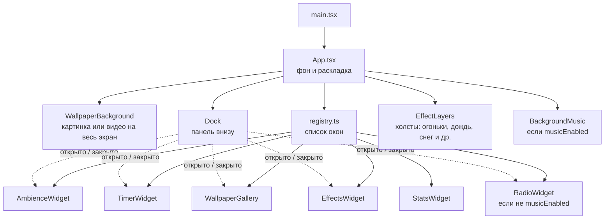

# Виджеты

Страница — это полноэкранные обои, поверх которых стоят независимые виджеты в окнах. Окна открываются и закрываются кнопками [панели](#панель) внизу экрана. Каждый виджет живёт в своей папке в `src/widgets/` и сам отвечает за свою логику и разметку. Какие окна есть, где они стоят и в какой группе панели их кнопка, описано в одном месте — в реестре [`src/widgets/registry.ts`](../src/widgets/registry.ts). `App.tsx` только раскладывает по нему страницу.

## Как устроена страница



Слои снизу вверх: обои → окна виджетов (`z-10`) → панель (`z-20`) → эффекты (`EffectCanvas`, `z-50`, не перехватывают клики). Тени облаков — исключение: они между обоями и окнами (`z-[1]`).

## Список виджетов

| Виджет             | Папка                                                 | Где на экране                      | Что делает                                                                                                                                                            |
| ------------------ | ----------------------------------------------------- | ---------------------------------- | --------------------------------------------------------------------------------------------------------------------------------------------------------------------- |
| `AmbienceWidget`   | [`src/widgets/ambience/`](../src/widgets/ambience/)   | Левый верхний угол                 | Микшер фоновых звуков: камин, дождь, ветер, шумы. Играет поверх радио. Подробно в [ambience.md](ambience.md)                                                          |
| `TimerWidget`      | [`src/widgets/timer/`](../src/widgets/timer/)         | Правый верхний угол                | Помидоро, обратный отсчёт и секундомер. Перед сигналом приглушает радио и звуки. Подробно в [timer.md](timer.md)                                                      |
| `StatsWidget`      | [`src/widgets/stats/`](../src/widgets/stats/)         | Сверху по центру                   | Статистика: сколько людей сейчас на сайте, серия дней с заходом и время на сайте. Подробно в [stats.md](stats.md)                                                     |
| `RadioWidget`      | [`src/widgets/radio/`](../src/widgets/radio/)         | Левый нижний угол                  | Интернет-радио: страны, станции, громкость, избранное. Подробно в [radio.md](radio.md)                                                                                |
| `WallpaperGallery` | [`src/widgets/wallpaper/`](../src/widgets/wallpaper/) | Правый нижний угол, под таймером   | Галерея обоев по категориям (Альянс, Орда, Warcraft, Япония) с прокруткой. Клик по превью меняет фон. Видео-обои помечены ▶. Подробно в [wallpaper.md](wallpaper.md)  |
| `EffectsWidget`    | [`src/widgets/effects/`](../src/widgets/effects/)     | Правый нижний угол, на месте обоев | Включение эффектов поверх страницы: огоньки, дождь, ливень, снег, листья, сакура, светлячки, тени облаков. Можно несколько сразу. Подробно в [effects.md](effects.md) |
| `BackgroundMusic`  | [`src/widgets/music/`](../src/widgets/music/)         | Не видна                           | Загруженные треки по кругу. **Сейчас скрыта** флагом `musicEnabled` в `App.tsx`                                                                                       |
| `Dock`             | [`src/widgets/dock/`](../src/widgets/dock/)           | Нижние углы и центр                | Не окно, а панель с кнопками окон. Подробно в разделе [Панель](#панель)                                                                                               |

`EffectCanvas` — не окно, а холст на весь экран поверх страницы, по одному на каждый включённый эффект. Включаются они в окне `EffectsWidget`.

## Общие части

| Что                                                                     | Зачем                                                                                                                                                                                                               |
| ----------------------------------------------------------------------- | ------------------------------------------------------------------------------------------------------------------------------------------------------------------------------------------------------------------- |
| [`src/widgets/Widget.tsx`](../src/widgets/Widget.tsx)                   | «Стеклянная» оболочка: полупрозрачный тёмный фон, размытие, рамка, тень, `z-10`. Рендерит `<section>`, принимает все его свойства. Там же `WidgetHeader` (подпись и кнопки справа) и `WidgetTitle` (мелкая подпись) |
| [`src/widgets/registry.ts`](../src/widgets/registry.ts)                 | Реестр окон: id, кнопка на панели, компонент, место на экране, общий `slot`. `WidgetId` выводится отсюда                                                                                                            |
| [`src/lib/storage.ts`](../src/lib/storage.ts)                           | Все ключи `localStorage` (`storageKeys`), безопасные `loadStored` и `saveStored`, общее хранилище `createPersistentStore`                                                                                           |
| [`src/hooks/usePersistentState.ts`](../src/hooks/usePersistentState.ts) | `useState`, который сохраняется в `localStorage`                                                                                                                                                                    |
| [`src/hooks/useMediaQuery.ts`](../src/hooks/useMediaQuery.ts)           | Совпадает ли медиазапрос (телефон, «уменьшить движение»). Сами запросы — `mediaQueries` в [`src/lib/media.ts`](../src/lib/media.ts), там же `matchesMedia` для кода вне React                                       |
| [`src/lib/audio.ts`](../src/lib/audio.ts)                               | Один `AudioContext` на страницу для звуков и сигнала таймера. `unlockAudio()` вызывать прямо в обработчике клика                                                                                                    |
| `scrollbar-glass` в [`src/index.css`](../src/index.css)                 | Тонкая полупрозрачная полоса прокрутки для стеклянных окон                                                                                                                                                          |
| [`src/hooks/useAutoplay.ts`](../src/hooks/useAutoplay.ts)               | Запуск звука в `<audio>`. Если браузер заблокировал автозапуск, ждёт первого клика или нажатия клавиши                                                                                                              |
| [`src/components/ui/`](../src/components/ui/)                           | Кнопка, комбобокс, слайдер, вкладки, прогресс. Всё, кроме кнопки, — на Base UI в стиле стеклянной панели                                                                                                            |

## Правила для виджетов

1. **Положение задаёт реестр, а не виджет.** Виджет принимает `className` и передаёт его в `<Widget>`. Ширину и место по брейкпоинтам пишут в поле `placement` в `registry.ts`, общие классы окна (`absolute`, прокрутка, вид на телефоне) добавляет `App.tsx`. Так виджет можно передвинуть, не трогая его код.
2. **Логика — в хуке, разметка — в компоненте.** Если состояния больше пары `useState`, оно уходит в `useИмяВиджета.ts` рядом с компонентом, как `useRadio`. Компонент только вызывает хук и рисует.
3. **Свои данные и API лежат в папке виджета.** Например, клиент Radio Browser — `src/widgets/radio/api.ts`, а не в общем `lib/`. В общие `src/hooks/` и `src/lib/` выносится только то, что нужно двум виджетам и больше.
4. **Каждый звуковой виджет управляет своим звуком сам.** Радио и музыка владеют своим `<audio>` и запускают его через `useAutoplay`, звуки — своим движком на Web Audio (`src/lib/ambience.ts`). Громкость все умножают на `useDuckLevel()`, чтобы затихать вокруг сигнала таймера. Музыка и радио взаимоисключающие (`musicEnabled` в `registry.ts`), а звуки рассчитаны на то, чтобы играть поверх них.
5. **Сохранение в браузере — через [`src/lib/storage.ts`](../src/lib/storage.ts).** Все ключи `tempo:*` перечислены там в `storageKeys`: новый ключ добавляй туда же, чтобы он не совпал с чужим. Ошибки хранилища (приватный режим) уже обработаны внутри. Каждое сохранённое значение проходит через функцию `parse`: она проверяет данные и переводит старые форматы, а `undefined` означает «взять значение по умолчанию». Что выбрать:
   - состояние одного хука — [`usePersistentState(key, fallback, parse)`](../src/hooks/usePersistentState.ts), как `useState`;
   - состояние, которое нужно нескольким компонентам, — `createPersistentStore` и `useSyncExternalStore(store.subscribe, store.get)`, как в `useWallpaper` (фон и галерея) и `useActiveEffects` (окно и холсты);
   - разовое чтение или запись — `loadStored` и `saveStored`, как последняя станция в `useRadio`.
6. **Подпись и кнопки — в общем стиле.** Шапка окна — `WidgetHeader` (подпись и кнопки справа), отдельная подпись — `WidgetTitle`. Кнопки — `Button variant="glass"` (белая иконка, подсветка при наведении), главная кнопка окна — `variant="glass-solid"`. Свои классы цвета кнопкам не пиши. У каждой кнопки с иконкой есть `title` и `aria-label` на русском.
7. **Виджет должен работать, когда его окно закрыто.** Закрытое окно не удаляется со страницы, а скрывается классом `hidden`: радио и звуки продолжают играть, таймер — идти. Не полагайся на то, что виджет видим.

## Панель

`Dock` — это три панели внизу экрана: «Звук» в левом нижнем углу под радио, «Статистика» по центру, «Вид» и «Фокус» в правом нижнем углу под таймером и обоями. Панели и их группы описаны в `dockPanels`, а кнопки окон попадают в группу из реестра по полю `dockGroup`. Их кнопки, сгруппированные по смыслу, открывают и закрывают окна виджетов. Подсвеченная кнопка — окно открыто. В группе «Статистика» после кнопки окна ещё часы и кнопка полноэкранного режима (поле `extra` у группы).

| Группа     | Кнопка     | Окно               |
| ---------- | ---------- | ------------------ |
| Звук       | Радио      | `RadioWidget`      |
| Звук       | Звуки      | `AmbienceWidget`   |
| Фокус      | Таймер     | `TimerWidget`      |
| Вид        | Обои       | `WallpaperGallery` |
| Вид        | Эффекты    | `EffectsWidget`    |
| Статистика | Статистика | `StatsWidget`      |

| Файл                                                                                | Что внутри                                                                                 |
| ----------------------------------------------------------------------------------- | ------------------------------------------------------------------------------------------ |
| [`src/widgets/dock/Dock.tsx`](../src/widgets/dock/Dock.tsx)                         | Разметка панели, `dockPanels`: где какая панель и какие в ней группы                       |
| [`src/widgets/dock/DockClock.tsx`](../src/widgets/dock/DockClock.tsx)               | Текущее время с компьютера в группе «Статистика». На телефоне скрыто                       |
| [`src/widgets/dock/FullscreenButton.tsx`](../src/widgets/dock/FullscreenButton.tsx) | Кнопка полноэкранного режима, как F11. Где Fullscreen API нет (iPhone), не показывается    |
| [`src/widgets/dock/useDock.ts`](../src/widgets/dock/useDock.ts)                     | Какие окна открыты, `isOpen` и `toggle`, сохранение в `localStorage`, определение телефона |

- **Открытые окна** — массив id в порядке открытия, последнее открытое в конце. Хранится в `tempo:open-widgets`.
- **При первом заходе** открыты обои, таймер и радио, звуки закрыты (`defaultOpen` в `useDock.ts`).
- **На телефоне** (уже 640px) видно только одно окно — последнее открытое. Новое окно заменяет текущее. Подписи групп на телефоне скрыты, чтобы панель поместилась.
- **Закрытое окно скрывается, а не удаляется**: `App.tsx` добавляет ему класс `hidden`. Поэтому радио и звуки продолжают играть с закрытым окном. См. [правило 7](#правила-для-виджетов).

## Раскладка на разных экранах

Брейкпоинты Tailwind: `sm` — от 640px, `lg` — от 1024px. Общие для всех окон классы — `windowClass` в `App.tsx`, свои у каждого окна — поле `placement` в `registry.ts`.

| Ширина экрана | Звуки                                         | Таймер                                         | Статистика                           | Радио                                | Обои и эффекты                                         |
| ------------- | --------------------------------------------- | ---------------------------------------------- | ------------------------------------ | ------------------------------------ | ------------------------------------------------------ |
| до 640px      | Над панелью во всю ширину                     | Над панелью во всю ширину                      | Над панелью во всю ширину            | Над панелью во всю ширину            | Над панелью во всю ширину                              |
| 640–1024px    | Левый верхний угол, ширина 22rem, отступ 1rem | Правый верхний угол, ширина 26rem, отступ 1rem | Сверху по центру, 18rem, отступ 1rem | Левый нижний угол над панелью, 26rem | Правый нижний угол над кнопками «Вид» и «Фокус», 30rem |
| от 1024px     | То же, отступ 2rem                            | То же, отступ 2rem                             | То же, отступ 2rem                   | То же, отступ 2rem                   | То же, отступ 2rem                                     |

- **Панели** — в левом нижнем углу, снизу по центру и в правом нижнем углу, отступ 1rem, от 1024px — 2rem.
- **Нижние окна стоят над панелью**: `bottom-24` (от 1024px — `bottom-28`), чтобы панель не наезжала на радио и обои на узких экранах.
- **Окно не выше экрана.** У всех окон есть `max-h` и `overflow-y-auto`: если содержимое не влезает, оно прокручивается внутри окна. У звуков высота ограничена сильнее, чтобы они не наезжали на радио в том же левом столбце: при длинном списке звуков окно прокручивается.
- **Таймер и обои (или эффекты) — в одном правом столбце** (`rightColumnClass`, у окон `column: 'right'` в реестре; порядок в столбце — порядок в реестре). С 640px таймер прижат к верху, обои — к низу, между ними зазор 1rem. Если обоим не хватает высоты, галерея сжимается (её сетка прокручивается), а не наезжает на таймер. На телефоне столбца нет (`contents`), окна встают по общему `windowClass`.
- **Обои и эффекты стоят на одном месте** и открываются по очереди: открытие одного окна закрывает другое (одинаковый `slot` в `registry.ts`).
- Таймер растёт вниз, когда меняет высоту (другая вкладка, запуск), и тогда галерея под ним становится ниже.

## Как добавить виджет

1. Создай папку `src/widgets/<имя>/` и компонент в ней:

   ```tsx
   import { cn } from '@/lib/utils';
   import { Widget, WidgetHeader } from '@/widgets/Widget';

   type ClockWidgetProps = {
   	className?: string;
   };

   export function ClockWidget({ className }: ClockWidgetProps) {
   	return (
   		<Widget aria-label="Часы" className={cn('flex flex-col gap-1.5 p-4', className)}>
   			<WidgetHeader title="Часы" />
   			{/* содержимое виджета */}
   		</Widget>
   	);
   }
   ```

2. Если логики много, вынеси её в `use<Имя>.ts` в той же папке. Настройки, которые должны пережить перезагрузку, храни через `usePersistentState` и добавь ключ в `storageKeys` (см. [правило 5](#правила-для-виджетов)).
3. Добавь запись в `definitions` в [`src/widgets/registry.ts`](../src/widgets/registry.ts) — больше ничего трогать не нужно: `WidgetId`, кнопка на панели и окно на странице появятся сами.

   ```ts
   {
   	id: 'clock',
   	label: 'Часы',
   	icon: Clock,
   	dockGroup: 'stats',
   	component: ClockWidget,
   	placement: 'sm:top-4 sm:bottom-auto sm:left-4 lg:top-8 lg:left-8'
   }
   ```

   Положение на телефоне уже задано общим `windowClass`. Окно в правом столбце под таймером — `column: 'right'`. Окно на месте другого (открывается вместо него) — одинаковый `slot` у обоих. Нужна новая группа на панели — добавь её id в `DockGroupId` и в `dockPanels` в [`Dock.tsx`](../src/widgets/dock/Dock.tsx).

4. Если окно должно быть открыто при первом заходе, добавь id в `defaultOpen` в [`useDock.ts`](../src/widgets/dock/useDock.ts).
5. Проверь раскладку на ширинах до 640px, 640–1024px и от 1024px.
6. Добавь строку в [список виджетов](#список-виджетов) и в таблицу [панели](#панель). Если у виджета есть неочевидная логика, заведи для него отдельный файл в `docs/`, как [radio.md](radio.md), и добавь ссылку в README.
